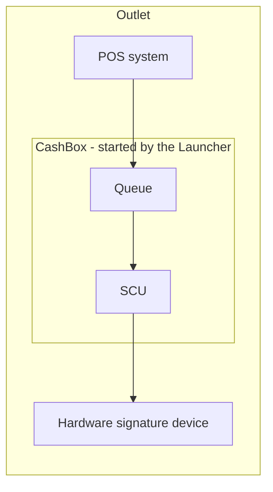
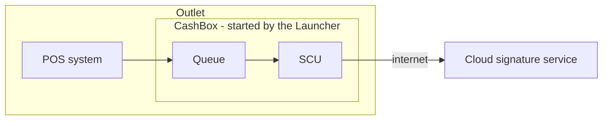
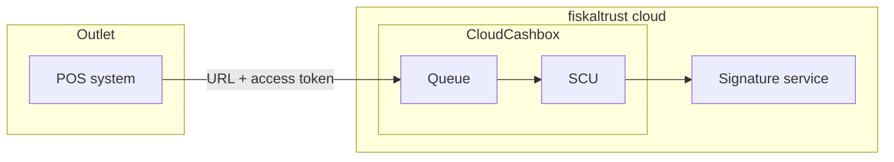
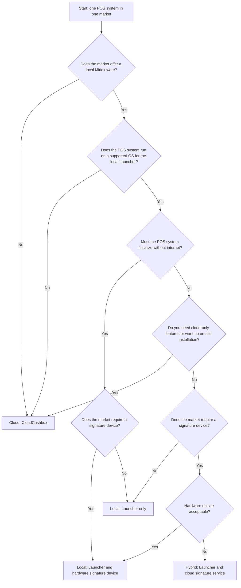

# Choosing a Middleware Architecture

:::info summary

After reading this, you can decide where the fiskaltrust.Middleware runs for your POS system, which signature device it uses, and what each choice means for operation, maintenance and market rollout.

:::

Your integration of the fiskaltrust.Middleware API is the same for every architecture. What changes is **where** the Middleware runs and **where** the signature is created. Make this decision before you set up your first CashBox, because it determines which platform you install on, which products your PosDealers order, and how your POS system reaches the Middleware.

Four questions decide the architecture:

1. Which operating system does the POS system run on?
2. Does the market require an additional signature device?
3. Is the signature device hardware-based or software-based (cloud)?
4. Does the Middleware run locally or in the cloud, and what are the consequences?

## Building blocks

Every architecture uses the same components. For details, see [Middleware Components](../middleware-doc/general/components/components.md).

| Component | What it does |
|---|---|
| **CashBox** | The configuration container in the fiskaltrust.Portal. It links one or more Queues and SCUs into one Middleware configuration. |
| **Queue** | The receipt chain. The POS system sends its requests to the Queue, which numbers, chains and stores the receipts. |
| **SCU** (Signature Creation Unit) | The component that connects the Queue to the market-specific signature device or service, for example a TSE in Germany. |
| **Signature device** | The hardware device, cloud service or certificate that creates the signature required by the market. In some markets, no separate device is needed. |
| **Launcher** | The program that starts the CashBox on a local device (Windows, Linux, macOS or Android). A Middleware hosted by fiskaltrust needs no Launcher. |

*Table 1. Components that make up every Middleware architecture.*

## The three architecture models

### Local: Middleware and signature device on site

The Launcher runs on the POS device or on a server in the outlet. The CashBox with the Queue and the SCU runs there, and the SCU talks to a signature device that is also on site, for example a hardware TSE on a USB port or microSD card.

*Figure 1. Local model: Middleware and signature device run in the outlet.*

- Signing does not depend on an internet connection, so the POS system can keep fiscalizing while offline. An internet connection is still recommended for configuration, updates and data services.
- The fiskaltrust.Middleware itself is free of charge and open source.
- You or your PosDealers install, update and maintain the Launcher and the signature device on every site.

### Hybrid: Middleware on site, signature in the cloud

The Launcher and the CashBox run on site as in the local model, but the SCU connects to a cloud signature service instead of a hardware device, for example a cloud TSE in Germany.

*Figure 2. Hybrid model: local Middleware with a cloud signature service.*

- No signature hardware has to be shipped, plugged in or replaced.
- Signing needs an internet connection. If the signature service cannot be reached, the Middleware switches to failed mode and the POS system continues to operate. For more information, see [Failure Scenarios](../middleware-doc/general/cash-register-integration/cash-register-integration-failure-scenarios.md#signature-creation-unit-not-reachable-or-failing).
- You still install and maintain the Launcher on every site.

### Cloud: Middleware hosted by fiskaltrust

fiskaltrust hosts the CashBox, including the Queue and the SCU, as the CloudCashbox. The POS system reaches the Middleware via a URL and authenticates with the CashBox ID and access token. Nothing is installed in the outlet.

*Figure 3. Cloud model: the CloudCashbox hosted by fiskaltrust.*

- No installation, no Launcher and no signature hardware on site. fiskaltrust operates and updates the Middleware.
- Every request needs an internet connection. If the Middleware cannot be reached, the POS system re-sends the receipts later in late-signing mode. For more information, see [Failure Scenarios](../middleware-doc/general/cash-register-integration/cash-register-integration-failure-scenarios.md#middleware-not-reachable-or-failing).
- The CloudCashbox is a paid product, while the locally installed Middleware is free of charge.
- The CloudCashbox is fiskaltrust's target architecture. Some features are only available with it, for example eInvoicing. For more information, see [eInvoicing — Overview](../middleware-doc/e-invoicing/overview.md#prerequisites-shared).

For more information, see [CloudCashbox](../../posdealers/technical-operations/middleware/launchers/cloudcashbox.md).

:::tip Self-hosted cloud POS systems in Germany

If your POS system runs in your own data center and you need the Middleware there, Germany also offers _Bring your own Data Center_ (Docker and Helm chart). fiskaltrust recommends the CloudCashbox over this setup. For more information, see [Custom data center](../../posdealers/technical-operations/middleware/launchers/custom-data-center.md).

:::

### Comparison

| | Local | Hybrid | Cloud |
|---|---|---|---|
| **Where the Middleware runs** | POS device or local server | POS device or local server | fiskaltrust cloud |
| **Signature device** | Hardware on site | Cloud service | Managed by fiskaltrust |
| **Installation on site** | Launcher and signature hardware | Launcher | None |
| **Internet for signing** | Not required | Required | Required |
| **Updates** | Through the Launcher on each site; on Android through an app update | Through the Launcher on each site; on Android through an app update | Done by fiskaltrust |
| **Middleware cost** | Free of charge | Free of charge | Paid product (CloudCashbox) |
| **Features only in the cloud** | Not available, for example eInvoicing | Not available, for example eInvoicing | Available |

*Table 2. Comparison of the three architecture models.*

## Decision factors

### 1. Operating system

The operating system of the POS device decides whether a local Launcher can run on it at all.

- **Windows**: Launcher available in every market that supports a local Middleware.
- **Linux and macOS**: Launcher available, but with restrictions per market and signature device. For example, SOAP/WCF is not available, and some German cloud TSEs support only specific Linux distributions.
- **Android**: Android Launcher available in some markets only, with a fixed set of preconfigured signature devices. Queue and SCU versions are bundled into the app, so updates are rolled out as app updates, ideally through a mobile device management solution.
- **iOS, web browsers or any other platform**: no local Launcher. Use the cloud model.

For more information, see [Supported Environments](../../posdealers/technical-operations/middleware/supported-environments.md) and [Launcher for Android](../../posdealers/technical-operations/middleware/launchers/android.md).

### 2. Is an additional signature device needed?

The market decides this, not you:

- **A signature device is required** in some markets, for example a TSE in Germany, a smart card or online signing service in Austria, an RT printer or RT server in Italy, or a fiscal printer in Poland.
- **No separate device is required** in other markets, for example France, Spain, Greece and Portugal. The signature is created with a certificate or key managed by the Middleware or by fiskaltrust.

See [Availability by market](#availability-by-market) for each market.

### 3. Hardware or cloud signature device

Where a signature device is required, the type limits your options:

| | Hardware device | Cloud service |
|---|---|---|
| **Examples** | Hardware TSE (USB, SD, microSD) in Germany, smart card in Austria, RT printer or RT server in Italy | Cloud TSE in Germany, online signing in Austria |
| **Fits architecture** | Local | Hybrid or cloud |
| **Works offline** | Yes | No |
| **On site** | Device must be connected, protected and replaced when defective | Nothing to install |
| **Sharing** | One device can serve several Queues in the same outlet, up to the device limit | Depends on the service; some cloud TSEs accept only one Queue |
| **Platform** | Needs a supported port and driver on the device | Needs network access; some services need an additional local component |

*Table 3. Hardware compared with cloud signature devices.*

Check the limits of each device before you decide. For Germany, see the [SCU/characteristics & platform support matrix](../middleware-doc/middleware-de-kassensichv/operation-modes/on-premise-installation.md#scucharacteristics--platform-support-matrix). For Italy, see the [SCU/characteristics & platform support matrix](../middleware-doc/middleware-it-registratore-telematico/operation-modes/installation.md#scucharacteristics--platform-support-matrix).

### 4. Local or cloud Middleware

Ask yourself the following questions:

- **Must the POS system keep fiscalizing without internet?** Only the local model with a hardware signature device signs without a connection.
- **Is the POS system itself cloud-based?** If your POS system already depends on the internet, the cloud model adds no new dependency and removes all on-site installation.
- **Who maintains the sites?** Every local or hybrid installation has to be installed, updated and monitored. With the cloud model, fiskaltrust does this.
- **Which features do you need?** Features such as eInvoicing are only available with the CloudCashbox.
- **Which API do you integrate?** The POS System API is available in the cloud in every market. A local POS System API needs Launcher 2.0 and the LocalPosSystemApi Helper, which is not available in every market. For more information, see [POS System API platforms](../../posdealers/technical-operations/possystem-api-platforms/overview.md).

## Availability by market

Not every model is available in every market, for legal or technical reasons. The table gives an overview; the linked market pages are authoritative.

| Market | Signature device | Local / hybrid Middleware | Cloud Middleware | Details |
|---|---|---|---|---|
| Austria | Smart card (hardware) or online signing service | Windows, Linux, macOS | Yes | [Austria](../middleware-doc/middleware-at-rksv/appendix-at-rksv.md#signing-cash-transactions) |
| Belgium | Fiscal Data Module (FDM), connected over HTTPS | Windows, Linux, Android | Yes | [Go-to-Market in Belgium](../middleware-doc/middleware-be/go-to-market/go-to-market.md#architecture) |
| France | None (certificate in the Middleware) | Windows, Linux, macOS (Middleware 1.2) | Yes | [Operation modes for France](../middleware-doc/middleware-fr-boi-tva-decla-30-10-30/operation-modes/operation-modes.md) |
| Germany | TSE: hardware (USB, SD, microSD) or cloud | Windows, Linux, macOS, Android (Swissbit hardware TSE or fiskaly cloud TSE) | Yes; Bring your own Data Center also available | [On-Premise Installation](../middleware-doc/middleware-de-kassensichv/operation-modes/on-premise-installation.md) |
| Greece | None (connector to the myDATA API) | Not available | Yes, cloud only | [Route 1](../middleware-doc/middleware-gr/go-to-market/route-1-fiskaltrust-licence.md#boundaries-of-this-route) |
| Italy | RT printer or RT server (hardware), or IVA Servizi (government web service, CloudCashbox only) | Windows, Linux, macOS, Android | Yes | [Installation for Italy](../middleware-doc/middleware-it-registratore-telematico/operation-modes/installation.md) |
| Poland (preview) | Fiscal printer (POSNET, hardware), connected over TCP | Not yet documented | Not yet documented | [Available SCUs](../middleware-doc/middleware-pl/cash-register-integration/cash-register-integration.md#available-scus) |
| Portugal | None (key held by fiskaltrust) | Only with your own certificate (route 2) | Yes; cloud only with the fiskaltrust certificate (route 1) | [The two routes](../middleware-doc/middleware-pt/go-to-market/go-to-market.md#the-two-routes) |
| Spain | None (qualified certificate held in the fiskaltrust cloud) | Not available | Yes, cloud only | [Go-to-Market in Spain](../middleware-doc/middleware-es/go-to-market/go-to-market.md#frequently-asked-questions) |

*Table 4. Signature devices and available architecture models per market.*

The hybrid model needs a cloud signature service, so it applies to markets where such a service is offered, for example Germany (cloud TSE) and Austria (online signing).

## Decision diagram

*Figure 4. Decision diagram for choosing a Middleware architecture.*

Different outlets of the same POS system can use different models. For example, a cloud POS system can use the CloudCashbox by default and a local installation only for outlets that must work offline.

## Planning Queues and outlets

The architecture also affects how you group Queues and signature devices:

- A Queue is a receipt chain and always belongs to one physical outlet. Queues and signature devices cannot be shared between outlets, because fiscal reporting is based on the physical outlet.
- Within one outlet, several terminals can share one Queue, or each terminal can have its own Queue. A separate Queue per terminal is more robust: a defective terminal cannot block the other terminals. Use separate Queues as well if an outlet needs several daily closings.
- In the local and hybrid models, several Queues in one CashBox can share one SCU and signature device, up to the limit of the device.

For example layouts with pros and cons, see [Rollout Scenarios](../../posdealers/technical-operations/rollout-scenarios.md).

## Checklist

Use this checklist to document your decision before you start the integration:

| Check item | Your answer |
|---|---|
| **Markets** in which the POS system will be sold | |
| **Operating systems** of the POS devices (Windows, Linux, macOS, Android, iOS, web) | |
| **Local Middleware available** in each of these markets on these operating systems | |
| **Signature device required** in each market, and which one | |
| **Hardware or cloud** signature device, and its limits (platforms, number of Queues) | |
| **Offline operation** required: yes or no | |
| **Who installs and maintains** the Middleware on site: you, your PosDealers, or nobody (cloud) | |
| **Cloud-only features** required, for example eInvoicing | |
| **API**: POS System API or classic Middleware API, and whether it is available locally in your markets | |
| **Queue layout** per outlet: one Queue per outlet or one per terminal | |
| **Chosen model** per market: local, hybrid or cloud | |

*Table 5. Checklist for documenting the architecture decision.*

When the decision is made, continue with the [Integration Steps](./middleware-integration.md) and the [Integration Checklist](./integration-checklist.md).

## Related pages

- [Operation Modes](../middleware-doc/general/operation-modes/operation-modes.md)
- [Middleware Components](../middleware-doc/general/components/components.md)
- [Rollout Scenarios](../../posdealers/technical-operations/rollout-scenarios.md)
- [CloudCashbox](../../posdealers/technical-operations/middleware/launchers/cloudcashbox.md)
- [Supported Environments](../../posdealers/technical-operations/middleware/supported-environments.md)
