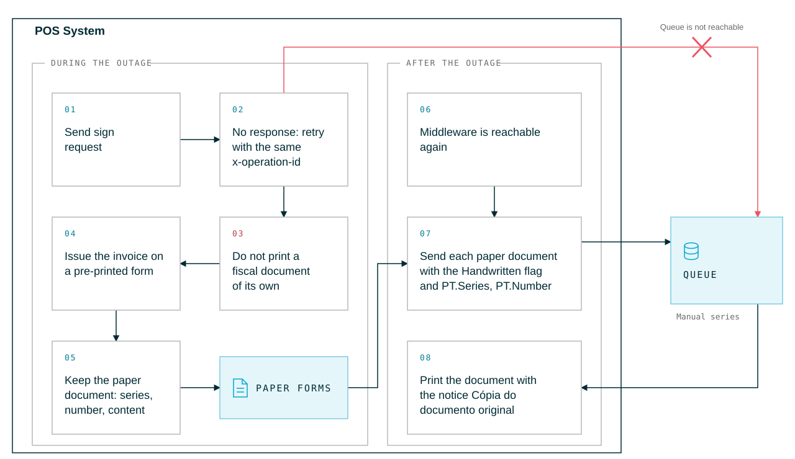

# Middleware Not Reachable

This page describes how the POS system behaves in Portugal when it cannot reach the fiskaltrust.Middleware, for example because of a network outage, a power outage or a failure of the POS system. The general failure scenarios are described in [Failure Scenarios](../../general/cash-register-integration/cash-register-integration-failure-scenarios.md) of the general part. In Portugal, the procedure differs from the general one: late signing is not available, and documents issued during the outage are recovered as handwritten documents.

## Why late signing is not possible in Portugal

In Portugal, invoices and other tax-relevant documents may only be issued by a certified invoicing program (see [Certification](../certification/certification.md)). The certified program is the Middleware: it numbers and signs the document and returns everything that must be printed on it, including the ATCUD, the hash characters and the QR code. A receipt that the POS system prints on its own, without a response from the Middleware, is not a valid fiscal document.

For this reason, the Portuguese Middleware does not support the late-signing flow described in the general part:

- The POS system must not hand out a receipt of its own marked "electronic recording system failed".
- The Middleware rejects a receipt whose `cbReceiptMoment` differs by more than 1 minute from the time at which it processes the receipt (see [Error Handling](error-handling.md#general-request-data)). Receipts that were created during the outage therefore cannot be sent later as regular receipts.

Instead, Portuguese law (*Despacho n.º 8632/2014*, section 2.4) defines how documents are issued while the invoicing program is not available and how they are integrated into it afterwards:

1. During the outage, documents are issued manually on **pre-printed forms** from a printing company authorized by the AT (*tipografia autorizada*).
2. After the outage, each of these documents is **recovered**: it is entered into the certified program, which issues it in a dedicated manual series with a reference to the paper document.



*Figure 1. Behavior of the POS system when the Middleware does not respond, during the outage and after the Middleware is reachable again.*

## Before an outage: prepare the fallback

- **Pre-printed forms.** The merchant keeps a stock of pre-printed forms from an authorized printing company for each document type that is issued, for example invoices. These forms carry their own series and sequential numbering, printed by the printing company.
- **Manual series in the Middleware.** The recovered documents are issued in a dedicated manual series per document type, which must be configured for the queue. On [Route 1](../go-to-market/route-1-fiskaltrust-certificate.md), fiskaltrust registers the series with the AT for you, including the manual series.
- **Recording in the POS system.** We recommend that the POS system offers a function to record a paper document after the outage, including the series and number of the form, so that the merchant does not have to enter it elsewhere.

## During an outage: what the POS system does

1. **Retry the request.** If the POS system does not receive a response, it retries the request with the same `x-operation-id` and the same body (see [Process-Driven and Idempotent Design](../../possystem-api/introduction.md#process-driven-and-idempotent-design)). If the Middleware has already processed the receipt, it returns the original response, and the document can be printed as usual.
2. **Do not issue a document without a response.** If the Middleware remains unreachable, the POS system must not print or hand out a fiscal document of its own. A request that did not receive a response must not be sent again later with its original `cbReceiptMoment`; it is rejected (see [Why late signing is not possible in Portugal](#why-late-signing-is-not-possible-in-portugal)).
3. **Switch to pre-printed forms.** The merchant issues the documents manually on the pre-printed forms of the respective document type.
4. **Keep the paper documents.** The data of every paper document is needed for the recovery: series and number of the form, date and time of issue, customer, line items, VAT rates and payments.

## After the outage: recover the paper documents

As soon as the Middleware is reachable again, each paper document is sent to the Middleware as a separate `ReceiptRequest`:

| Field | Value |
|-------|-------|
| `ftReceiptCase` | The receipt case of the document type of the paper document with the flag `Process as Handwritten Receipt` (`0x0000_0000_0008_0000`), for example `0x5054_2000_0008_1001` for a B2C invoice. |
| `ftReceiptCaseData` | The series and number printed on the paper form, in `PT.Series` and `PT.Number`. `PT.Series` must not contain spaces; `PT.Number` must be at least 1. |
| `cbReceiptMoment` | The date and time at which the paper document was issued, in UTC. For handwritten receipts, the Middleware accepts a `cbReceiptMoment` in the past. |
| `cbReceiptReference` | A new, unique reference for the recovered document. |
| `cbChargeItems`, `cbPayItems`, `cbCustomer` | Exactly the content of the paper document. |

*Table 1. Fields of a `ReceiptRequest` that recovers a paper document.*

Example of the fields that are specific to the recovery:

```json
{
  "ftReceiptCase": 5788286605450547201,
  "ftReceiptCaseData": {
    "PT": {
      "Series": "ABC123",
      "Number": 42
    }
  },
  "cbReceiptReference": "recovery-ABC123-42",
  "cbReceiptMoment": "2026-10-12T14:35:00Z"
}
```

`5788286605450547201` is the decimal value of `0x5054_2000_0008_1001` (B2C invoice with the `Process as Handwritten Receipt` flag). Complete the request with the user, customer, charge items and pay items of the paper document.

The Middleware then:

- issues the document in the manual series of its document type, with its own number, ATCUD, hash and QR code,
- returns the notice `Cópia do documento original` with the series and number of the paper document in the signature items, for example `Cópia do documento original - FTM <series>/<number>` for an invoice, which must be printed together with the regular elements (see [Copies, voids, and manual documents](../receipt-printing/receipt-printing.md#copies-voids-and-manual-documents)),
- uses the date of the paper document as the document date and the time of recovery as the system entry date, and marks the document as manual (`M`) in the SAF-T (PT) export, with the reference to the paper document.

:::warning

- Which paper documents can be recovered depends on the document type: a document type can be recovered only if a manual series is configured for it. For the document types and their receipt cases, see [Certified document types](../certification/certification.md#certified-document-types).
- The `Process as Handwritten Receipt` flag cannot be combined with refunds, partial refunds or voids.
- Each combination of series and number can be recovered only once. If the Middleware rejects a paper document as already recorded, do not send it again.

For all validation rules that apply to handwritten receipts, see [Error Handling](error-handling.md#handwritten-receipts).

:::

### Refunds and voids of recovered documents

A recovered document is a regular document of its document type in the Middleware. To refund it, send a refund without the `Process as Handwritten Receipt` flag and set `cbPreviousReceiptReference` to the `cbReceiptReference` of the recovery request. For more information, see [References, refunds, voids and payment transfers](error-handling.md#references-refunds-voids-and-payment-transfers).
