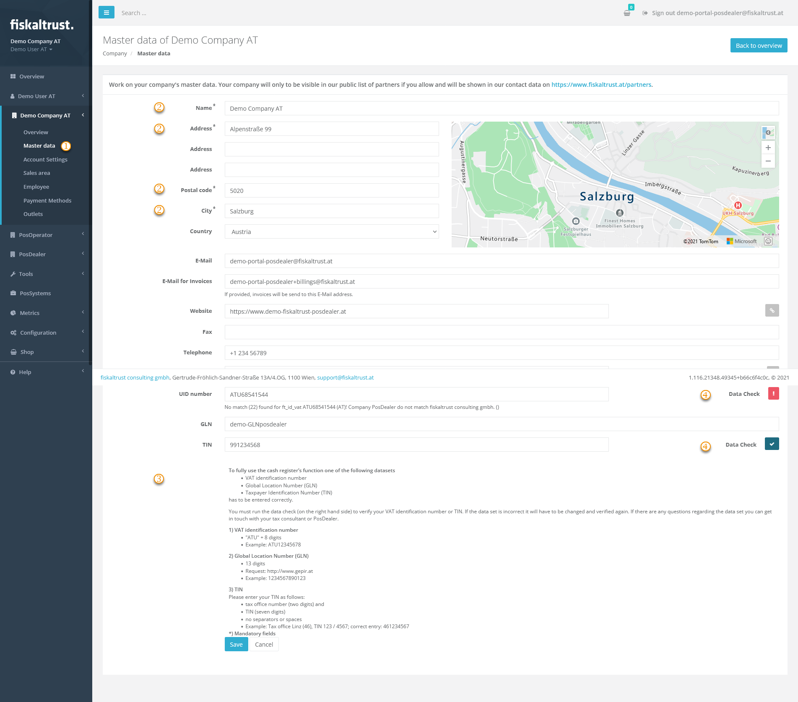
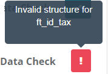

#### Preview

*Figure 1. Master data page in the fiskaltrust.Portal.*

| Step | Description |
|:----:|-------------|
| |In the fiskaltrust.Portal, choose `Company info` > `Master data`. |
| |Check that the fields marked with * contain correct and complete data. |
| |Check the tax identification numbers against the explanations below the data fields. Observe the notes on notation, such as the number of digits and the omission of spaces, and whether one or more values are required; this varies from country to country. |
| |Check the entered values with `Data Check` to the right of the data fields. |

*Table 1. Steps to check and complete the master data.*

| Data check result | Meaning |
|:-----------------:|---------|
| |The value in the data field has not been checked yet. |
| |The value is invalid. Hover over the symbol to see the description, change the value accordingly and run the data check again. |
| |The value is valid. This does not protect against duplicates. |

*Table 2. Data check result symbols and their meaning.*
