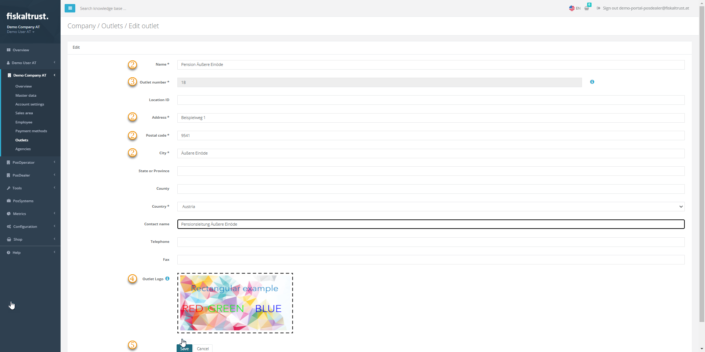

#### Preview

*Figure 1. Edit outlet page in the fiskaltrust.Portal.*

To open the page, choose `Company info` > `Outlets` and choose `Edit` for the outlet you want to check or edit.

| Step | Description |
|:----:|-------------|
| |The address data is relevant for the automated invoice generation between PosDealer and PosOperators and for the digital receipt. |
| |You can set the `Outlet number` when you create the outlet manually, but you cannot change it afterwards. |
| |Under `Outlet Logo`, choose `Select Image File` to upload an image that customizes the digital receipts of this outlet. |
| |Choose `Save` to save your changes, or `Cancel` to return to `Company info` > `Outlets`. |

*Table 1. Fields and buttons of the Edit outlet page, shown in Figure 1.*
