Since 2025, the activation and deactivation of electronic recording systems must be reported to the responsible tax office.

## Notifications workflow

The notifications workflow **enables PosDealers to support their PosOperators** during onboarding with structured and trackable notifications. It makes sure that the company, outlet and cash register data are complete and correct, which is essential for fiscalization and compliance.

*Figure 1. Workflow of the tax authority notifications in Germany.*

### Roles and responsibilities

- **PosDealer**: enables notifications, helps with data entry and troubleshooting, tracks the status, and makes sure that the PosOperators complete the onboarding form.
- **PosOperator**: enters correct company, outlet and cash register data and submits the onboarding form.
- **fiskaltrust**: provides technical support to PosDealers and helps solve system or data issues.

### Open the notifications page

In the Portal, open `PosDealer` > `PosOperator Notifications` in the left sidebar. The page lists all your PosOperators and the status of their notifications.

### Subscription requirements

You can enable notifications only if the PosOperator has an **active subscription** to one of these products:

- fiskaltrust.Carefree without TSE
- fiskaltrust.Carefree with TSE-as-a-Service
- fiskaltrust.Finanzamtsmeldung

You buy these subscriptions in `Rollout management`. For more information, see [Rollout management](../../../../buy-resell/rollout-plans.md).

Without a valid subscription, the notifications drop-down of the PosOperator is **disabled**. Buy the product first, then enable the notifications.

### Enable notifications

1. Open the notifications drop-down of the PosOperator and select `Enabled`.

   The fiskaltrust.Portal sends an **onboarding email** to the PosOperator. It explains the notification process and contains a link to the data form.

   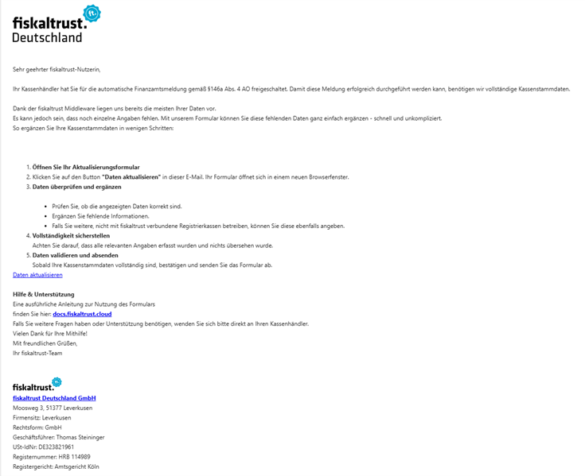

   *Figure 2. The onboarding email to the PosOperator.*

2. The PosOperator completes the form in four steps:
   1. Company information
   2. Outlet details
   3. Cash register setup
   4. Final review and submission

   The form can be submitted only if **all required fields** are complete and correct. For more information, see [Instructions for the PosOperator form](#instructions-for-the-posoperator-form).

### Why accurate data matters

Notifications need **complete and correct data**. Missing or wrong data prevents the notification from being sent, for example:

- a wrong **Steuernummer** (tax number)
- a missing **PosSystemId**
- an incomplete address

### Notification lifecycle

After the PosOperator submits the form, the system **schedules** the notification for the next available time slot. The frequency and timing follow an internal schedule.

If the PosOperator has not submitted the form, you can **resend the onboarding email** from the fiskaltrust.Portal. You can also:

- enable or disable notifications
- filter by status
- trigger the sending of a notification manually
- review the **Issues** listed per PosOperator, for example missing data

When the notification was successful, the PosOperator receives a **confirmation email** with the ELSTER transmission protocol (ELSTER-Übermittlungsprotokoll) attached.

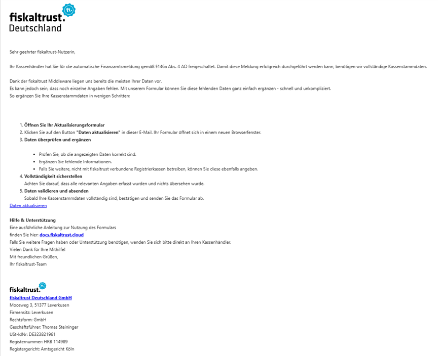

*Figure 3. The confirmation email with the ELSTER transmission protocol.*

### Responsibilities per step

| Step | PosDealer | PosOperator |
| --- | --- | --- |
| 1. Check the subscription | Check that the PosOperator has an active subscription to fiskaltrust.Carefree without TSE, fiskaltrust.Carefree with TSE-as-a-Service or fiskaltrust.Finanzamtsmeldung. If needed, buy the product in `Rollout management` or extend the subscription in the subscriptions page. | — |
| 2. Enable notifications | Open the notifications page and set the notification status of the PosOperator to `Enabled`. This sends the onboarding email. | — |
| 3. Enter the data | — | Open the onboarding email and complete the four steps of the form: company details, outlet information, cash register setup, and review and submission. |
| 4. Validate the data | Follow the progress of the PosOperator on the notifications page. Resend the onboarding email if the form was not submitted or if the PosOperator asks for the link. Check the **Issues** column for missing or wrong data, and help the PosOperator correct it. | Correct the errors highlighted in the form. Contact the PosDealer for help if needed. |
| 5. Track the status | Track the notification status (scheduled, sent, failed, blocked). Enable, disable or trigger notifications manually. Use filters to prioritize PosOperators. Keep records for compliance and support. | Watch for the confirmation and follow-up emails. Stay informed if notifications are paused or disabled. |
| 6. Ongoing support | Keep in touch with your PosOperators. Contact fiskaltrust support for technical issues. | Contact the PosDealer with questions or for help. |

*Table 1. Responsibilities of the PosDealer and the PosOperator per step.*

## Troubleshooting and support

### Common problems

- **Wrong outlet configuration**: if a Queue is linked to the wrong outlet, correct the outlet configuration.
- **Duplicate outlets**: if several outlets represent the same physical location, for example virtual duplicates, group them with the `Location ID` field when you edit the outlet.

### Notification failures

If a notification fails:

1. Check the **Issues** column for missing or wrong data.
2. Help the PosOperator correct the data.
3. If needed, resend the onboarding email.

If notifications are disabled and enabled again later:

- The PosOperator can still access the form.
- Notifications are sent only while their status is `Enabled`.
- Inform your PosOperators clearly when notifications are paused.

### Email and status communication

- **PosDealers** see the current status in the fiskaltrust.Portal and can opt in to **summary emails**, weekly or every two weeks.
- **PosOperators** receive the onboarding email and updates.

### Best practices for PosDealers

- Check the notification status and the **Issues** column regularly.
- Actively help your PosOperators complete the form.
- Use filters to prioritize, for example failed notifications.
- Use bulk actions to manage many PosOperators efficiently.
- Keep records for compliance and support.

## Legal basis

- Law: [§ 146a Abs. 4 AO](https://www.gesetze-im-internet.de/ao_1977/__146a.html)
- Application decree: [Anwendungserlass zu § 146a AO](https://www.bundesfinanzministerium.de/Content/DE/Downloads/BMF_Schreiben/Weitere_Steuerthemen/Abgabenordnung/AO-Anwendungserlass/2023-06-30-AEAO-Par-146-AO.pdf?__blob=publicationFile&v=1)

### When a notification is mandatory

- **Initial commissioning** of the cash register. With the fiskaltrust.Middleware, this corresponds to the initial-operation receipt.
- **Decommissioning** of the cash register. With the fiskaltrust.Middleware, this corresponds to the out-of-operation receipt.
- **Changes**: whenever the mandatory data of the last notification changes, a new notification updates the data at the tax authorities, for example when you change the TSE or the mandatory master data.

### Deadlines

A notification is due within one month of an initial commissioning, a decommissioning, or an update or correction of the previous notification.

For the start of the notifications in 2025, a transition period applied:

- Cash registers commissioned before July 1, 2025 had to be included in a notification by July 31, 2025.
- Cash registers decommissioned before July 1, 2025 need to be included only if they were part of a notification before. fiskaltrust does not report cash registers decommissioned before July 1, 2025.
- Cash registers commissioned on or after July 1, 2025 must be included in a notification within one month.

## Technical background

:::info
The following information can change in the future.
:::

All cash registers of an outlet must be included in the notification. For cash registers that use the fiskaltrust.Middleware, fiskaltrust already has most of the information. Cash registers that do not use the fiskaltrust.Middleware can also be added to the notification in several ways. fiskaltrust generates the notification and submits it to ELSTER through the ERiC interface.

If data for the notification of an outlet is missing, an automated process asks the PosOperator to provide it.

### Prerequisites for PosDealers and PosOperators

fiskaltrust generates the notification from the data in the fiskaltrust.Middleware and the fiskaltrust.Portal, so the PosOperator's account needs certain master data. The PosOperator is asked for missing values before the notification is created, but the more values are already filled in, the less the PosOperator needs to enter later.

| Source | Path | Value | Description |
|---|---|---|---|
| PosOperator account | `Company info` > `Master data` | Tax number | The tax number (Steuernummer) is mandatory. The VAT ID number (USt-IdNr.) cannot be used. |
| PosOperator account | `Company info` > `Master data` | Address | Street name and house number are mandatory. |
| PosOperator account | `Company info` > `Master data` | Postal code | Mandatory. |
| PosOperator account | `Company info` > `Master data` | City | Mandatory. |
| PosOperator account | `Company info` > `Outlets` | Address | Street name and house number are mandatory. |
| PosOperator account | `Company info` > `Outlets` | Postal code | Mandatory. |
| PosOperator account | `Company info` > `Outlets` | City | Mandatory. |

*Table 2. Master data required in the PosOperator account for the notification.*

### Prerequisites for PosCreators

The notification needs no new implementation. However, some processes, receipts and data that were already part of the fiskaltrust.Middleware are now mandatory for the notification:

- **Receipts**: the initial-operation receipt, the out-of-operation receipt, the initiate-switch receipt and the finish-switch receipt.
- **PosSystemId**: mandatory from the beginning. fiskaltrust uses it to map the master data of your POS system to the individual Middleware instances. The POS system master data is a mandatory part of the notification.

## Instructions for the PosOperator form

With this form, the PosOperator updates the cash register data for the notification to the tax office (§ 146a Abs. 4 AO).

:::info
The notification can be sent only if no information is missing and all fields contain valid data.
:::

### 1. Overview of the steps

After you open the form link, the form shows the steps to complete.

You can go back to previous steps at any time. You can also close the form and open it again with the same link: your progress is saved.

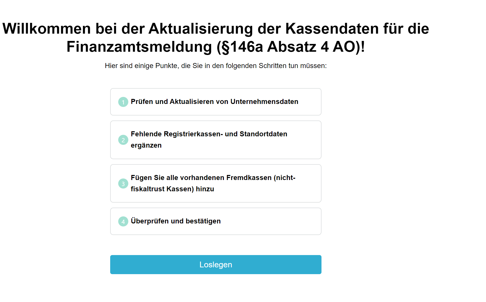

*Figure 4. The opening page of the form with the steps to complete.*

### 2. Verify the company data

Check the displayed master data of the company headquarters, which is the address for which the tax office assigned the tax number, and correct it in the form if needed.

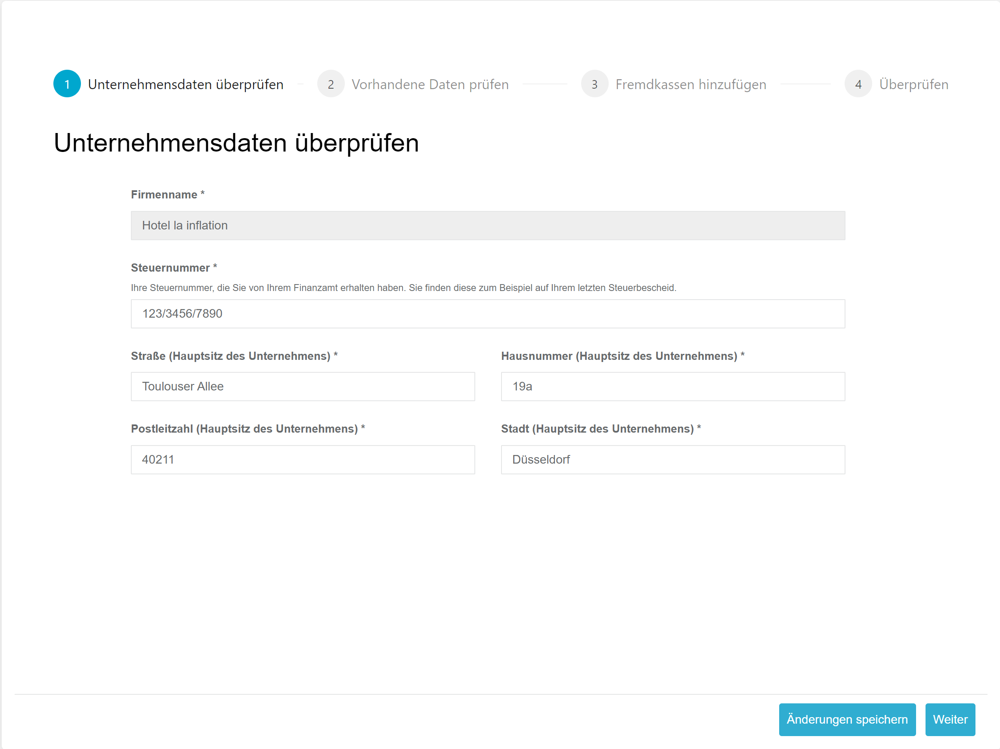

*Figure 5. The company data step of the form.*

| Field | Description |
|---|---|
| Tax number | The tax number assigned by the tax office. You find it on your last tax notice, usually at the top. **Important:** do **not** enter the tax identification number (IdNr.) here. Enter the tax number in the format shown on the tax notice. |
| Street, house number, postal code and city of the company headquarters | The address registered for this tax number. Individual outlets follow later in the form. |

*Table 3. Fields of the company data step.*

The following example tax notice shows where to find the tax number.

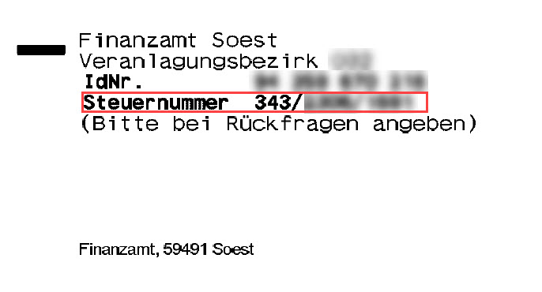

*Figure 6. An example tax notice with the tax number.*

### 3. Review the existing data

The form shows the data fiskaltrust already has about the outlets and cash registers. Each outlet is listed in its own row. Missing or invalid data is marked in red.

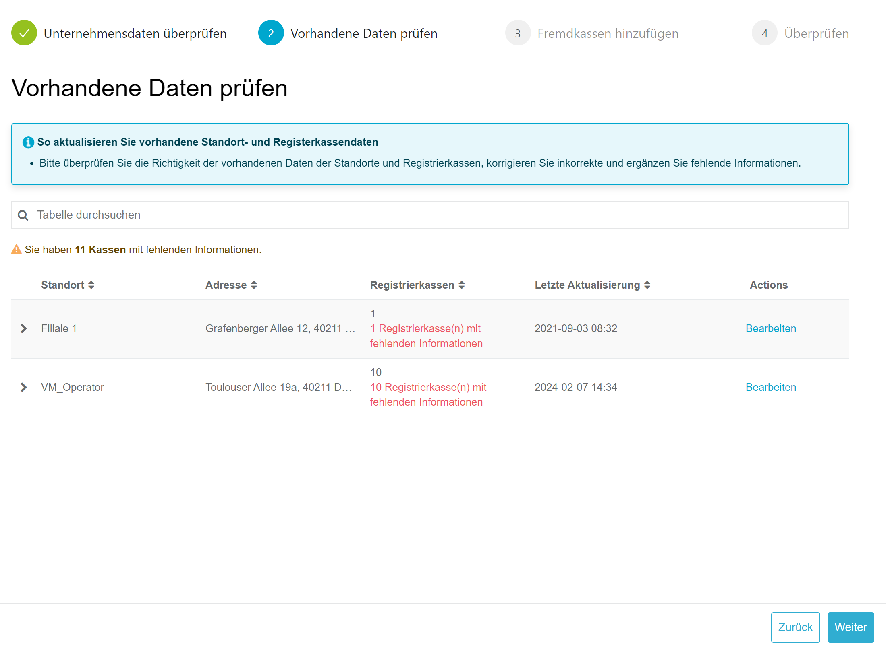

*Figure 7. The existing outlet data, with missing or invalid data marked in red.*

#### Verify and edit the outlet data

1. Check the displayed address of the outlet. To correct it, click `Edit` in its row.

   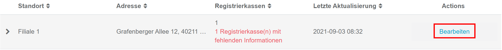

   *Figure 8. The `Edit` button of an outlet.*

2. Correct the outlet data and save it.

   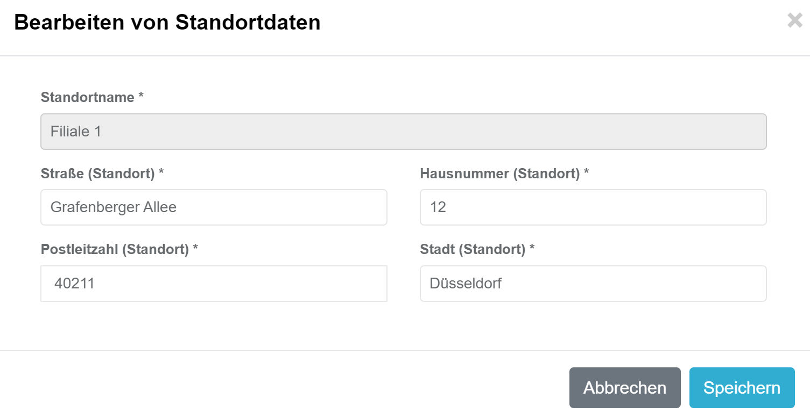

   *Figure 9. The dialog to edit the outlet data.*

#### Edit the cash register data

Missing mandatory cash register data is shown in red. If more cash registers are listed than actually exist at the outlet, deactivate them in the cash register software or in the fiskaltrust.Portal. If in doubt, contact your cash register provider.

1. To list the cash registers of an outlet, click the **>** button next to the outlet name.

   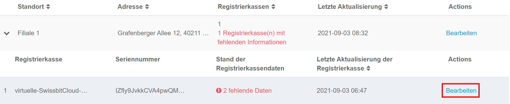

   *Figure 10. The cash registers of an outlet.*

2. To add missing data, click `Edit` for the cash register, enter the data and save it.

   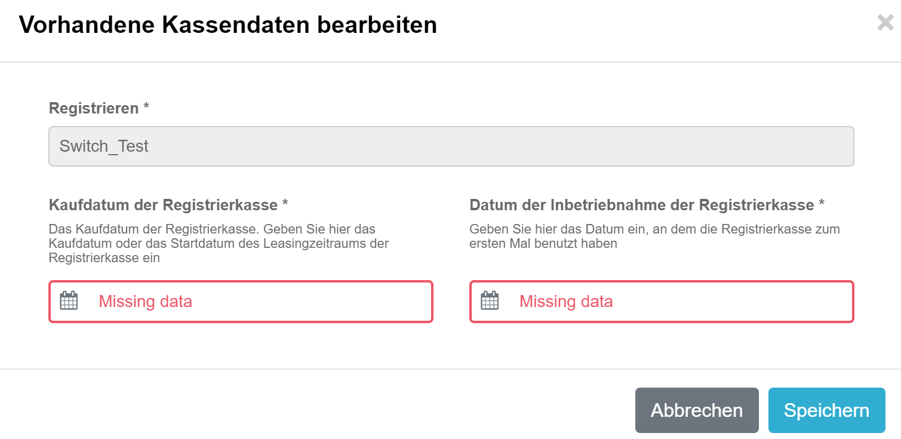

   *Figure 11. The dialog to edit the cash register data.*

| Field | Description |
|---|---|
| Purchase date of the cash register | The purchase date (invoice date) or the start of the lease of the cash register. |
| Activation date of the cash register | The date from which the cash register could be used for business transactions. **Note:** the TSE activation does not matter here. |

*Table 4. Fields of the cash register dialog.*

#### Complete the review

When all data is added or corrected, all outlets and cash registers are marked in green.

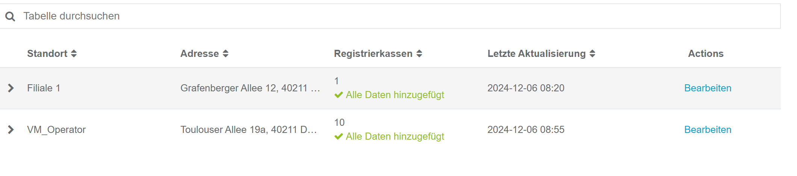

*Figure 12. All outlets and cash registers marked green.*

### 4. Add external cash registers

Cash registers at your outlets that are not listed in [step 3](#3-review-the-existing-data) are **external cash registers**. This usually happens when an outlet uses cash registers from several manufacturers that are not all connected to the fiskaltrust.Middleware.

By law (§ 146a Abs. 4 AO), all cash registers of an outlet must be reported, so add every cash register that is not shown in step 3.

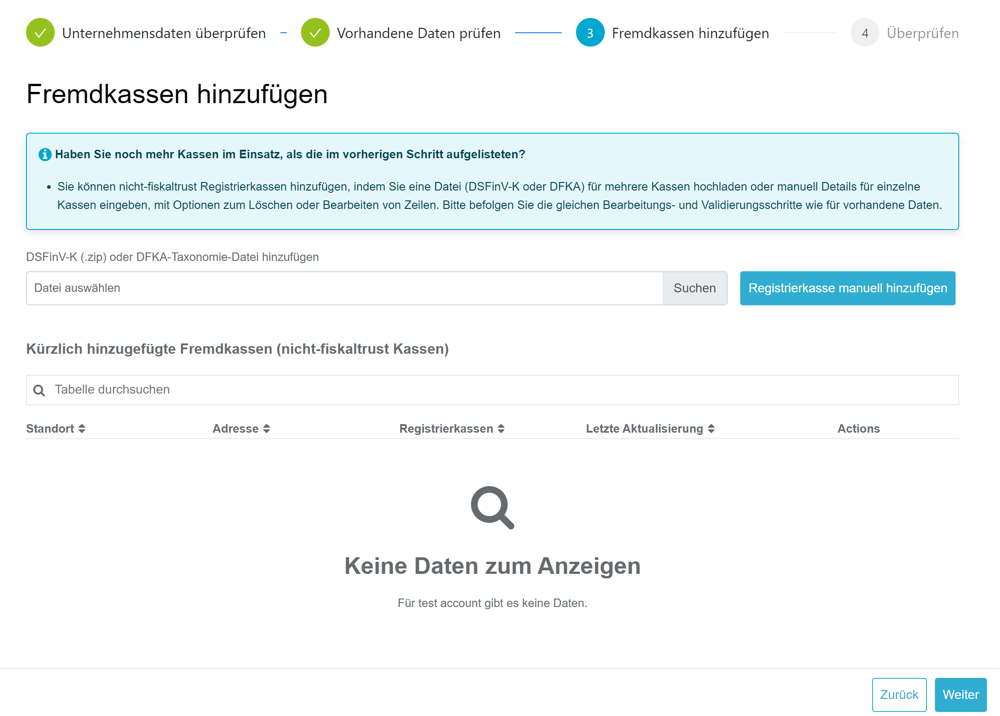

*Figure 13. The step to add external cash registers.*

You add external cash registers in one of two ways.

#### Import a DSFinV-K (ZIP) or DFKA taxonomy (JSON) file

Every cash register must support the DSFinV-K export. You can use a DSFinV-K export to add the missing cash registers. It can contain all cash registers of an outlet or only some of them.

:::info
The import works only if the export follows the legal structure and definition. If errors occur during the import, contact the manufacturer.
:::

1. Click `Choose File` and select the DSFinV-K file in ZIP format.

   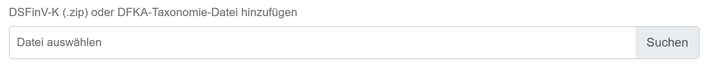

   *Figure 14. Choosing the DSFinV-K file.*

2. Click `Import File`.

   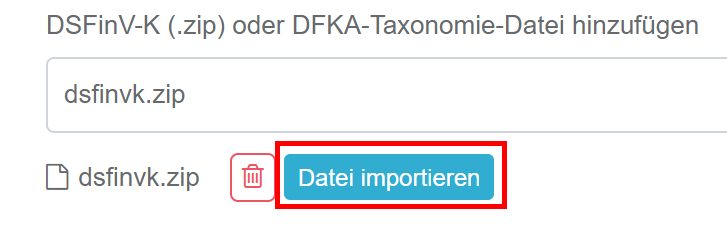

   *Figure 15. Importing the DSFinV-K file.*

3. Select the outlet the DSFinV-K comes from and click `Import`.

   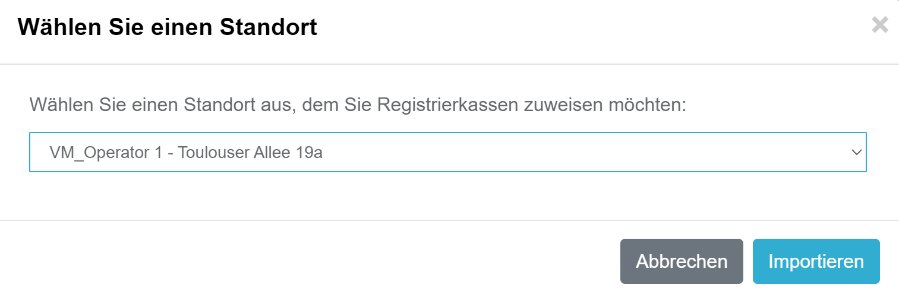

   *Figure 16. Selecting the outlet of the DSFinV-K.*

**Result:** The list shows the imported cash registers per outlet. You can repeat the import as often as needed.

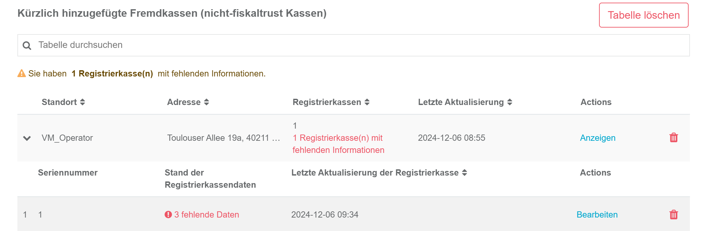

*Figure 17. The imported cash registers per outlet.*

#### Add a cash register manually

If a DSFinV-K export is not possible or the import fails, click `Manually Add Cash Register` and enter the data.

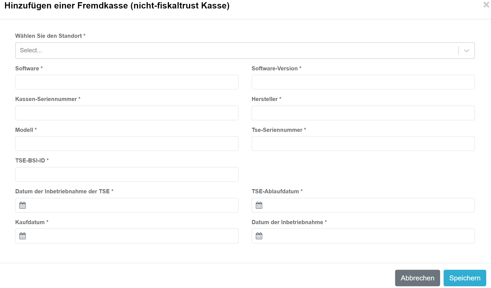

*Figure 18. Adding a cash register manually.*

| Field | Description |
|---|---|
| Software | The name of the cash register software. |
| Software version | The version or designation of the software. |
| Cash register serial number | Must match the serial number registered in the TSE. You find it on the receipts. |
| Manufacturer | The manufacturer of the cash register. |
| Model | The model name of the cash register. |
| TSE serial number | The serial number of the TSE used. |
| BSI-ID | Every TSE is certified by the BSI and has a BSI-ID. You find it on [Wikipedia](https://de.wikipedia.org/wiki/Technische_Sicherheitseinrichtung#%C3%9Cbersicht_der_zertifizierten_TSE). Enter the value without `BSI-K-TR-`, for example `0412-2020`. |
| TSE activation date | The date the TSE was activated. |
| Purchase date | The purchase date (invoice date) or the start of the lease of the cash register. |
| Activation date | The date from which the cash register could be used for business transactions. |

*Table 5. Fields to add an external cash register manually.*

#### Complete or remove cash registers

- If data is still missing after the import or the manual entry, complete or correct it as described in [Edit the cash register data](#edit-the-cash-register-data). For the fields, see *Table 5*.
- If wrong cash registers were imported or the wrong outlet was selected, remove them with the trash icon.

  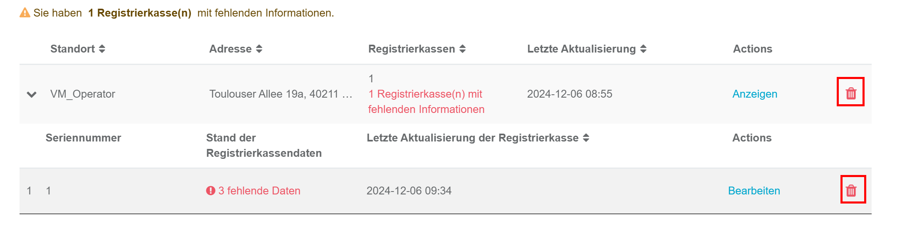

  *Figure 19. Removing an outlet or a cash register.*

### 5. Complete the form

The form shows all steps you performed, including any missing or invalid information. The notification can be sent only if all steps are free of errors.

1. Check the overview.

   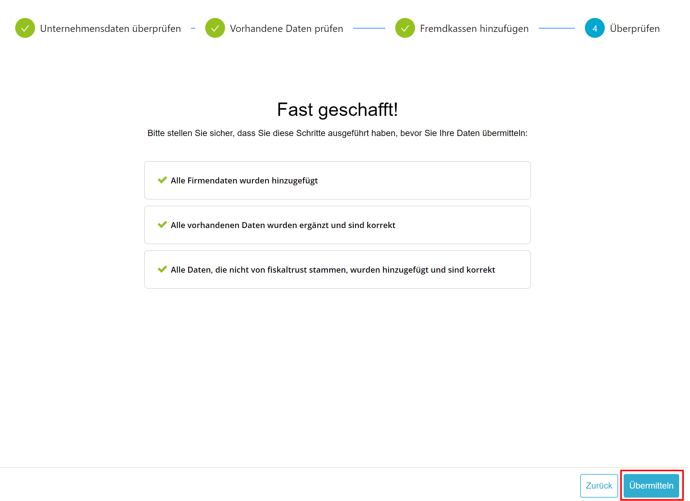

   *Figure 20. The overview of all steps.*

2. Click `Submit`, then confirm that the data is correct and complete.

   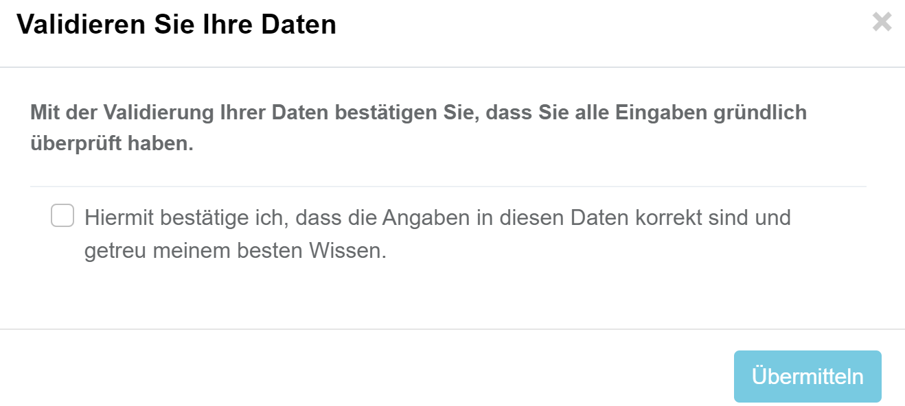

   *Figure 21. The confirmation of the data.*

**Result:** The PosOperator receives an email about the data update. The data is sent to the tax office on the following Sunday. The PosOperator then receives the ELSTER transmission protocol. Store it in your procedural documentation.

## Find the data for the ELSTER form

If you prefer to enter the data manually in the ELSTER form instead of using the fiskaltrust process, *Table 6* shows where to find it.

| XML or ELSTER form field | DSFinV-K table | DSFinV-K field | Data for ELSTER | Where to find it |
|---|---|---|---|---|
| Aufzeichnung146a/StNr | cashpointclosing | STNR | Operator.Account.masterData.TaxId | `Company info` > `Master data` |
| AllgAngabenNichtNatuerlichePerson/Firmenname | cashpointclosing | NAME | Operator.Account.masterData.AccountName | `Company info` > `Master data` |
| AllgAngabenNichtNatuerlichePerson/Adresse/AdrInl/Strasse | cashpointclosing | STRASSE | Operator.Account.masterData.Street | `Company info` > `Master data` |
| AllgAngabenNichtNatuerlichePerson/Adresse/AdrInl/Hausnummer | cashpointclosing | STRASSE | Operator.Account.masterData.Street | `Company info` > `Master data` |
| AllgAngabenNichtNatuerlichePerson/Adresse/AdrInl/Postleitzahl | cashpointclosing | PLZ | Operator.Account.masterData.Zip | `Company info` > `Master data` |
| AllgAngabenNichtNatuerlichePerson/Adresse/AdrInl/Ort | cashpointclosing | ORT | Operator.Account.masterData.City | `Company info` > `Master data` |
| AngabenZuBetriebsstaette/AnzahlAufzeichnungssysteme | | | Configuration.Queue | Total number of active Queues |
| AngabenZuBetriebsstaette/Adresse/Strasse | location | LOC_STRASSE | Operator.Account.Outlet.Street | `Company info` > `Outlets` |
| AngabenZuBetriebsstaette/Adresse/Hausnummer | location | LOC_STRASSE | Operator.Account.Outlet.Street | `Company info` > `Outlets` |
| AngabenZuBetriebsstaette/Adresse/Postleitzahl | location | LOC_PLZ | Operator.Account.Outlet.Zip | `Company info` > `Outlets` |
| AngabenZuBetriebsstaette/Adresse/Ort | location | LOC_ORT | Operator.Account.Outlet.City | `Company info` > `Outlets` |
| AngabenAufzeichnungssystem/Art | | | | Select it from the drop-down in the ELSTER form |
| AngabenAufzeichnungssystem/Software | cashregister | KASSE_SW_BRAND | fiskaltrust.Middleware | Enter `fiskaltrust.Middleware` |
| AngabenAufzeichnungssystem/SoftwareVersion | cashregister | KASSE_SW_VERSION | 1.3 | Enter the Middleware version (1.3) |
| AngabenAufzeichnungssystem/SeriennummerAS | cashregister | Z_KASSE_ID | CashboxIdentification | `Configuration` > `Queues`, Queue details |
| AngabenAufzeichnungssystem/Hersteller | cashregister | KASSE_BRAND | Creator.Account.posSystem.Brand | Provided by the manufacturer |
| AngabenAufzeichnungssystem/Modell | cashregister | KASSE_MODELL | Creator.Account.posSystem.Model | Provided by the manufacturer |
| AngabenAufzeichnungssystem/SeriennummerTSE | tse | TSE_SERIAL | Configuration.Signature Creation Unit.Details.SerialNumberOctet | `Configuration` > `Signature creation unit`, details, `SerialNumberOctet` |
| AngabenAufzeichnungssystem/InbetriebnahmeTSE | | | Queue.ActionJournal.Initial-Operation | `Configuration` > `Queues`, `ActionJournal`: select the initial-operation receipt and enter its date |
| AngabenAufzeichnungssystem/BSIID | tse | TSE_ZERTIFIKAT | Configuration.Signature Creation Unit.Details.CertificationIdentification | `Configuration` > `Signature creation unit`, details, `CertificationIdentification` |
| AngabenAufzeichnungssystem/AnschaffungAS | | | Not provided by fiskaltrust | Date of the cash register acquisition |
| AngabenAufzeichnungssystem/InbetriebnahmeAS | | | Not provided by fiskaltrust | Date of the cash register commissioning |

*Table 6. ELSTER form fields, the matching DSFinV-K fields, and where to find the data.*

For the guidelines of the Federal Ministry of Finance, see the [FAQ and completion instructions (PDF)](https://www.bundesfinanzministerium.de/Content/DE/Downloads/Steuern/FAQ-Ausfuellanleitung.pdf?__blob=publicationFile&v=2).

## FAQ

For further questions, send an email to support@fiskaltrust.de.

### What is the acquisition date of the cash register?

The acquisition date is the date of purchase or the start of the lease of the cash register. Both the acquisition date and the commissioning date are independent of the start of fiscalization. For example, if you bought a cash register in 2005 and connected a TSE to it in 2021, the acquisition date is in 2005. fiskaltrust is not permitted to provide legal advice. For detailed questions about the acquisition date, contact a tax advisor.

### Can the manufacturer or dealer enter the form data?

Both the cash register dealer and the cash register manufacturer can manage the data in the fiskaltrust.Portal.

### In what format is the tax number entered?

The 13-digit nationwide standard tax number is not required, but you can enter it if you know it. Enter the tax number in the format the tax office assigned to you. You find it, for example, on any tax assessment notice.

### Which contact receives the link to the PosOperator form?

The email with the link is sent to the primary contact of the PosOperator account registered in the fiskaltrust.Portal.

### How often is a notification required?

A notification to the tax office is required only for a new entry or a change in the data. For example, a cash register remains active for the tax office until its deactivation is reported.

### Is there an automatic way to update the data?

For customers with many cash registers and outlets, there will be an option to update the data collectively.
