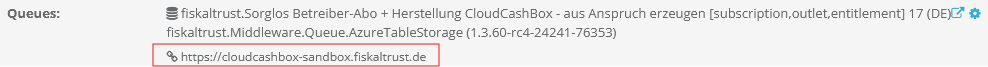

:::caution

This example uses REST as a communication protocol and requires your Queue to have a configured `rest://` URL.

:::

To send an echo request, send a `POST` request to the path `/v1/Echo` of the configured Middleware URL.

You find the Middleware URL on the CashBox configuration page in the Portal.



*Figure 2. Middleware URL on the CashBox configuration page in the fiskaltrust.Portal.*

The request body is a JSON object with a single string field, `Message`, that contains the message you want the Middleware to return:

```json
{
    "Message": "Hello fiskaltrust.Middleware!"
}
```

:::info

For a CloudCashbox, add the `cashboxid` and `accesstoken` headers to the request. You also find both values on the CashBox configuration page.

:::

The following HTTP request sends the minified JSON object from above, with the message `Hello fiskaltrust.Middleware!`, to a CloudCashbox:

```http
POST  https://cloudcashbox-sandbox.fiskaltrust.de/v1/Echo HTTP/1.1
Host: localhost
Content-Length: 46
Content-Type: application/json
cashboxid: XXXX
accesstoken: XXXX

{ "Message": "Hello fiskaltrust.Middleware!" }
```

The response has the status code `200` and contains the same object, with the exact string you sent, in the response body.

:::info

For the full request details, parameters and a curl example, see the [Echo request in the Middleware samples](https://middleware-samples.docs.fiskaltrust.cloud/#11f73789-cf7d-4510-bf2c-d3698e954dac).

:::
