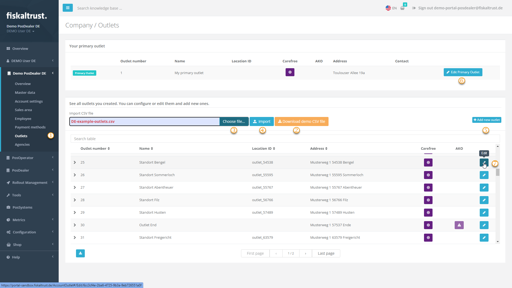

#### Outlets

*Figure 1. Outlets page in the fiskaltrust.Portal.*

| Step | Description |
|:----:|-------------|
| |Choose `Company info` > `Outlets` and check the existing values. |
| |If several outlets are missing, choose `Download demo CSV file`. |
| |Open the CSV file, add the values and save it. Go back to `Company info` > `Outlets` in the fiskaltrust.Portal and select the file with `Choose` under `Import CSV file`. |
| |Choose `Import`. The data is checked and listed on the `Bulk import of outlets` page. Choose `Proceed with valid outlets`. |
| |If only a single outlet is missing, choose `+Add new outlet`. |
| |`Edit Primary Outlet` changes the address values that you have checked in `Company info` > `Master data`. |
| |To change the data of an outlet, choose `Edit`. |

*Table 1. Steps to check and edit outlets.*
