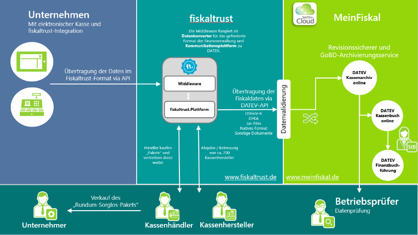
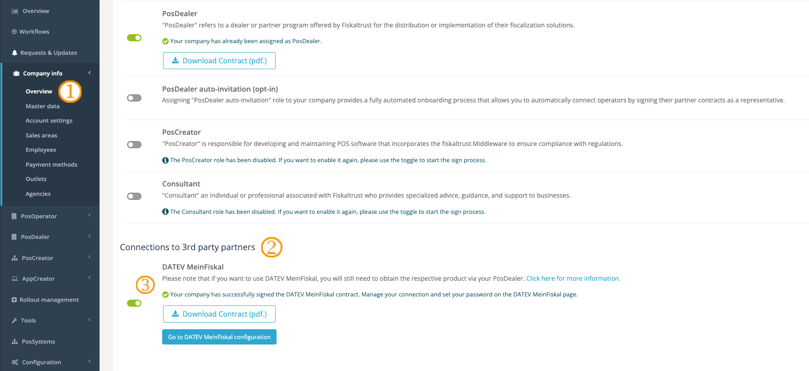
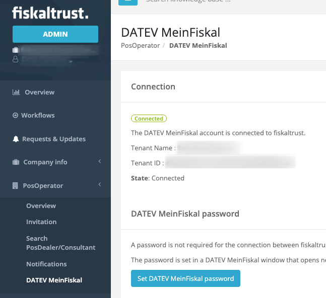
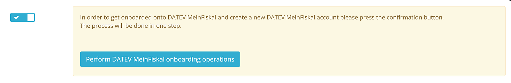
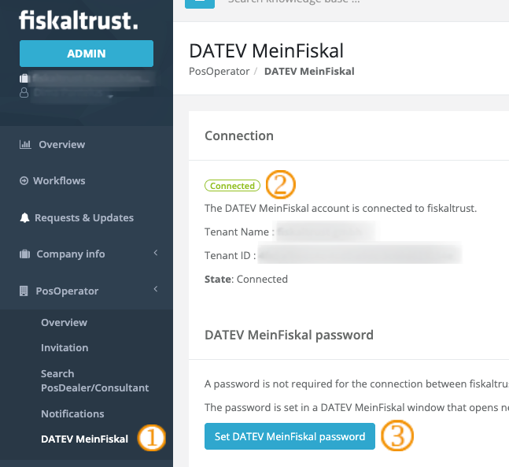

# DATEV MeinFiskal

:::info summary

After reading this, you understand the benefits of connecting a fiskaltrust account to **DATEV MeinFiskal** for PosOperators, and you can set up the connection as a PosDealer.

:::

:::caution Austria and France

**DATEV MeinFiskal** is available only in Germany, so this page does not apply to Austria or France. The links to DATEV lead to German-language documentation.

:::

- [DATEV](https://www.datev.de/) offers fiscalization solutions for companies in Germany. Its solutions for electronic cash management meet all legal requirements.
- [DATEV MeinFiskal](https://www.meinfiskal.de/) is an open cloud platform hosted by DATEV. PosCreators, TSE providers and fiskaltrust have joined the platform.
- DATEV MeinFiskal is part of the **fiskaltrust.Carefree** product bundle. The data is transferred from the fiskaltrust.Portal to the DATEV MeinFiskal platform through an automated interface.

The fiskaltrust.Carefree bundle also includes [DATEV Kassenarchiv online](https://www.datev.de/web/de/berufsgruppenuebergreifend/mydatev/cloud-anwendungen/datev-kassenarchiv-online). In addition to [revision-safe archiving](../revision-safe-archiving.md) in fiskaltrust's cloud, it archives end-of-day totals, individual records and other tax-relevant documents daily as an **extended memory** of the POS system. With DATEV Kassenarchiv online, your PosOperator gets a higher level of legally compliant data security:

- additional storage that prevents data loss
- proof that nobody can change the POS system data
- compliance with the GoBD
- an audit-proof archive for the statutory retention period
- data storage in DATEV data centers

Tax consultants and authorities are introducing digital workflows for their clients. With the [DATEV Kassenbuch online](https://www.datev.de/web/de/shop/produkt-details/kassenbuch-online-95150) interface, POS data for financial accounting goes directly to the tax advisor's DATEV software. Up-to-date data also creates transparency for an upcoming tax audit.

## Process

### PosCreator

1. The PosCreator adds a POS system in the fiskaltrust.Portal, which assigns it a **PosSystemId**. A valid PosSystemId is required to register PosOperators with DATEV MeinFiskal.
2. The PosCreator invites PosDealers to use this POS system.
3. The PosCreator checks the implementation with a DFKA export. The PosDealer can start the onboarding only when the validation report of the DFKA export contains no errors. **Onboarding to DATEV MeinFiskal is allowed only if the validation report contains no errors.**

For this check, create one daily closing that contains all business cases your POS system offers. This way, you find errors that would prevent the import into DATEV MeinFiskal later.

#### Check the DFKA export

1. In the Portal, open `Configuration` > `Queues` in the left sidebar.
2. Click `Export` for the Queue and select `DFKA`.
3. Extract the downloaded ZIP file and open the file `validation-report.json`.
4. Check that the field `isValid` is `true`.

If `isValid` is `false`, the DFKA contains errors. They are listed in the `Errors` field and always refer to the DFKA itself (`dfka.json`). During the export, the fiskaltrust backend validates `dfka.json` against the schema in `taxonomie-schema.json`. This is a standard JSON schema validation, which you can reproduce with tools like the [JSON Schema Validator](https://www.jsonschemavalidator.net/). Invalid DFKA exports are not imported into DATEV MeinFiskal.

| Error | Cause |
|-------|-------|
| Does not validate against content encoding `base64` cash_point_closing.security.tse.modules[0].certificate | The certificate of the TSE is missing. Check that the TSE is active in the fiskaltrust.Portal. |
| JSON does not match any schemas from `anyOf` cash_point_closing.head.company | The tax number or the VAT ID is missing; at least one of them is required. Check `Company info` > `Master data` in the fiskaltrust.Portal. |
| String 'XXXX' does not match regex pattern `^[A-Z]{2}.{1,13}` cash_point_closing.head.company.location.vat_id_number | The VAT ID has the wrong format. Check that it has the format DE123456789 in `Company info` > `Master data`. |
| Required properties are missing from object: brand, model, base_currency_code cash_point_closing.head.company.location.cash_register | The POS system master data is missing. Check that the PosSystemId is included in all requests to the fiskaltrust.Middleware. |
| JSON is valid against no schemas from `oneOf` cash_point_closing.transactions[X].head.references[X] | A reference to another system is missing mandatory data. Check the [ReceiptCaseData reference rules](../../../../poscreators/middleware-doc/middleware-de-kassensichv/data-structures/data-structures.md#receipt-case-data-ftreceiptcasedata). |

*Table 1. Common errors in the DFKA validation report and their causes.*

### PosDealer and PosOperator

1. The PosDealer activates DATEV MeinFiskal in the fiskaltrust.Portal by signing the **user agreement** on behalf of the PosOperator.
2. Customer data such as the **e-mail address** and the **tax number** (St.-IdNr. or USt-IdNr.) is exchanged between the fiskaltrust.Portal and the [DATEV MeinFiskal](https://www.meinfiskal.de/) platform.
3. A DATEV MeinFiskal user account and password are created automatically at DATEV.
4. The PosDealer receives an onboarding email from fiskaltrust with instructions to reset the account's password. The PosOperator receives a similar email about the successful onboarding.

**Result:** The DATEV MeinFiskal account is fully operational, and the PosOperator can use its services such as DATEV Kassenarchiv online. Further services, such as DATEV Kassenbuch online, are available on the DATEV MeinFiskal platform. fiskaltrust generates the legally required data formats (DSFinV-K, DFKA taxonomy, TAR files, the native format and other documents) and handles the connection and data transfer to DATEV MeinFiskal through the fiskaltrust.Portal.

*Figure 1. Interfaces and data flow between the fiskaltrust.Portal and the DATEV MeinFiskal platform.*

## Set up DATEV MeinFiskal

### Prerequisites

:::info

For a PosOperator to use DATEV MeinFiskal, the PosDealer buys at least one Carefree subscription, or the standalone product [DATEV MeinFiskal Kassenarchiv online](https://portal.fiskaltrust.de/#/Shop/Product/4445-041040), for that PosOperator.

- It does not matter whether the [fiskaltrust.Carefree subscription](https://portal.fiskaltrust.de/#/Shop/Product/4445-021040) was bought with or without the additional product [TSE-as-a-Service](https://portal.fiskaltrust.de/#/Shop/Product/4445-021050).
- You do not need a Queue or a CashBox to set up the connection. However, for a successful data backup with DATEV MeinFiskal, a Queue and a CashBox must be set up and activated. If problems occur, see [Troubleshooting](#troubleshooting).

:::

To see all your POS systems and their **PosSystemId**, open `PosSystems` in the left sidebar of the Portal. If no POS system is listed, contact your PosCreator.

The following requirements must be met. Otherwise, complete the PosOperator onboarding first, or the PosOperator performs the setup. For more information, see [Invitation](../../../getting-started/operator-onboarding/invitation-process.md).

1. The PosOperator has an account in the fiskaltrust.Portal and has accepted fiskaltrust's general terms and conditions and the PosOperator user agreement.
2. The PosOperator or the PosDealer has checked the master data. For more information, see [Master data](../../../getting-started/operator-onboarding/master-data.md).
3. As a PosDealer, you have full authorizations (`Full (Write/Read, Contract Conclusion)`) for the PosOperator's account.

#### Master data limits

DATEV checks the master data during the onboarding. *Table 2* lists the maximum number of characters and the regular expression for each value.

| Master data | Maximum number of characters | Regular expression |
|-------------|------------------------------|--------------------|
| AccountName | 32 | `^[^\s].*[^\s]$` |
| City | 42 | `^[^\s].*[^\s]$` |
| Mail | 32 | Standard e-mail address |
| Firstname | 32 | `^[^\s].*[^\s]$` |
| PostalCode | Exactly 5 | `^\d{5}$` |
| Street | 32 | `^[^\s].*[^\s]$` |
| Surname | 32 | `^[^\s].*[^\s]$` |
| VatId | 11 | `^DE[0-9]{9}$` |

*Table 2. Maximum number of characters and regular expressions for the master data used in the DATEV onboarding.*

#### Address validation

DATEV strictly checks the address data: the city and the street must belong to the postal code registered with Deutsche Post. To check your address, use the [PLZ check](https://www.postdirekt.de/plzserver/) of Deutsche Post.

### Check the contract conclusion permission

1. Sign in to the fiskaltrust.Portal as a PosDealer.
2. Open `PosDealer` > `PosOperators` in the left sidebar.
3. If needed, enter a search term to narrow down the list.
4. Check the authorizations of the PosOperator: `Contract conclusion` must be active.
5. If it is not active, contact the PosOperator to activate it for you.

### Check the master data

1. Switch to the PosOperator's account. For more information, see [Switch to a PosOperator account](../../../getting-started/operator-onboarding/surrogating.md#switch-to-a-posoperator-account).
2. Open `Company info` > `Master data` in the left sidebar.
3. Check that every mandatory field, for example the name and the address, is filled in.
4. Check that the validity check succeeds with either the tax number (St-IdNr) or the VAT ID (USt-IdNr).
5. Click `Save`.

### Connect the account

:::tip

The DATEV MeinFiskal account is created automatically during the connection. **Do not create** a DATEV MeinFiskal account for your PosOperator in advance: fiskaltrust cannot delete accounts in the DATEV portal that were created by others.

:::

1. Buy a product required for DATEV MeinFiskal. For more information, see [Prerequisites](#prerequisites).
2. Sign in to the PosOperator account, or switch to it, and open `Company info` > `Overview` in the left sidebar.
3. In `Connections to 3rd party partners`, turn on the `DATEV MeinFiskal` toggle, if it is not on yet.

   

   *Figure 2. The `Connections to 3rd party partners` section with the `DATEV MeinFiskal` toggle.*

4. Read the contract **Nutzungsvertrag über die Nutzung von DATEV MeinFiskal** and sign it.

   Signing starts a background process. Give it enough time to complete and do not refresh the page. Leaving the page, or signing out and in again, does no harm. You can download the signed contract at any time.

**Result:** If the connection was successful, the fiskaltrust.Portal shows the connection details, and you receive a welcome email with further instructions as a PosDealer.

*Figure 3. A successful DATEV MeinFiskal onboarding.*

### Retry a failed connection

If the background process failed, the fiskaltrust.Portal shows a notice with the button `Perform DATEV MeinFiskal onboarding operations`.

*Figure 4. The notice shown when the connection failed.*

1. Check the master data. For more information, see [Check the master data](#check-the-master-data).
2. Open `Company info` > `Overview` in the left sidebar.
3. Click `Perform DATEV MeinFiskal onboarding operations`.

## Status check for a single PosOperator

1. Sign in to the PosOperator account, or switch to it, and open `PosOperator` > `DATEV MeinFiskal` in the left sidebar.

   

   *Figure 5. The DATEV MeinFiskal onboarding status and details.*

2. Check the connection details and status.
3. To change the password of the DATEV MeinFiskal account, click `Set DATEV MeinFiskal password`. You can do this at any time.

## Troubleshooting

- **The PosDealer cannot sign the DATEV MeinFiskal user agreement for the PosOperator**: the PosDealer is not authorized. Contact the PosOperator to get the authorization.
- **The onboarding fails with messages like "Prüfen Sie die Stammdaten"**: open `Company info` > `Master data` and check the following:
  - The **e-mail address** contains no `+`.
  - The **name fields** contain no `.`.
  - No **spaces** were entered before or after the values.
  - The **names** have at most 32 characters. The fiskaltrust.Portal accepts up to 100 characters, but DATEV MeinFiskal accepts at most 32.
- **The PosDealer can no longer sign in to DATEV MeinFiskal** because the login data is lost: the PosDealer cannot request another password-reset email on the DATEV MeinFiskal website. Only the PosOperator can, after receiving the welcome email with the link to change the password.

## Import troubleshooting

Some common mistakes prevent the data from being uploaded to DATEV MeinFiskal or cause errors in the DATEV MeinFiskal overview.

| Error | Solution |
|-------|----------|
| No data visible in DATEV MeinFiskal | Usually the DFKA is not valid. For common errors and help, see [Check the DFKA export](#check-the-dfka-export). |
| Data of one daily closing is missing in DATEV MeinFiskal | Usually the DFKA is not valid. For common errors and help, see [Check the DFKA export](#check-the-dfka-export). If only one daily closing is affected, a rarely used receipt case can be the cause. |
| Errors in the DATEV MeinFiskal overview about mismatching revenue totals | Usually the ChargeItems and PayItems of some receipts do not match. Check that the ChargeItem totals match the PayItem totals in all receipts. The Middleware returns errors if they do not match, and the receipt check in the fiskaltrust.Portal shows errors. Use the receipt check in the fiskaltrust.Portal to find the affected receipts. |

*Table 3. Common data import issues in DATEV MeinFiskal and their solutions.*
