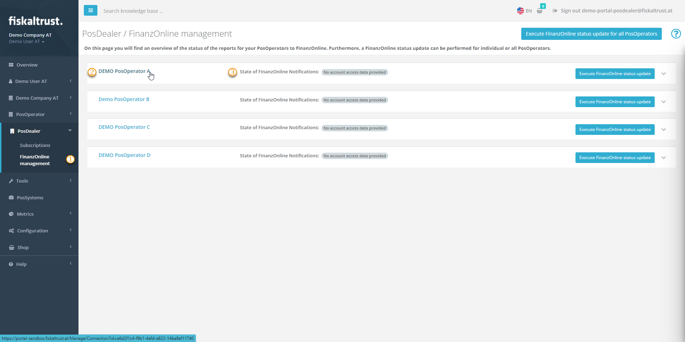
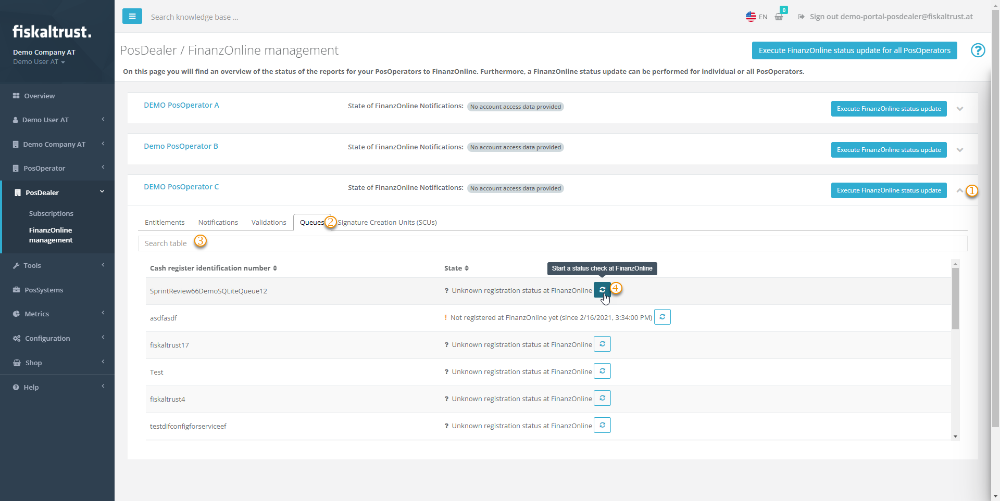
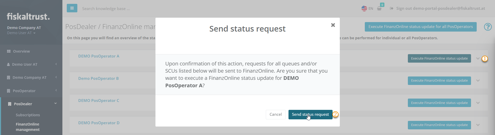
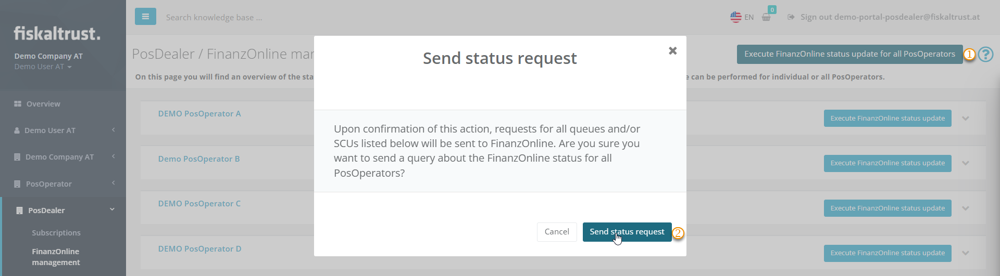

# FinanzOnline management

:::info summary

After reading this, you understand the benefits for PosOperators of connecting their fiskaltrust account to FinanzOnline, and you can check the FinanzOnline status of your PosOperators as a PosDealer.

:::

:::caution Germany and France

FinanzOnline management is available only in Austria, so this page does not apply to Germany or France. Some of the links on this page lead to FinanzOnline documentation, which is available only in German.

:::

- The **Carefree bundle** includes FinanzOnline notifications: the registration of signature creation units, and the notifications and checks for cash registers, for example the start, annual and stop receipts. PosOperators without a Carefree bundle can buy the notifications.
- PosOperators get an overview in `Tools` > `FinanzOnline notifications`.
- As a PosDealer, you get an overview of the FinanzOnline connections and the status of the notifications in `PosDealer` > `FinanzOnline management`.

A reconciliation with FinanzOnline is needed only if you or the PosOperator changed Queues or SCUs manually in FinanzOnline.

## FinanzOnline

The FinanzOnline ordinances created the legal basis for FinanzOnline in Austria in 2006. FinanzOnline provides electronic access to the tax authorities for entrepreneurs and their representatives. It offers round-the-clock access to relevant tax documents without additional software, and the services of the company service portal (USP), such as e-Rechnung. FinanzOnline is continuously being developed into an information and transaction portal for tax matters.

### Prerequisites for PosOperators

As a PosDealer or PosOperator, you start by creating or entering the access data of a FinanzOnline user. This user must be created specifically for the POS system web service. You also need enough entitlements for FinanzOnline: PosOperators with a Carefree package have unlimited access to them, and PosOperators without a Carefree package can buy them.

1. Sign in to the fiskaltrust.Portal and check the existing entitlements of the account: open `Shop` > `Entitlements` in the left sidebar and look for `AT_FON_NOTIFICATION`. If none are available, buy them in `Shop` > `Products`.
2. Open `Tools` > `FinanzOnline notifications` and register your FinanzOnline data.

## FinanzOnline management for PosDealers

### Prerequisites for PosDealers

A PosOperator is listed in `PosDealer` > `FinanzOnline management` only if:

- the contract is active
- an SCU or a Queue is active in the PosOperator's account
- notifications for FinanzOnline are created

If a PosOperator is missing from the list, see [Troubleshooting](#troubleshooting).

:::warning

The `PosDealer` > `FinanzOnline management` page has the button `Perform FinanzOnline status update for all PosOperators`. Do not click it without a reason. First read this section, including [Status check for all PosOperators](#status-check-for-all-posoperators).

:::

### Review the FinanzOnline connections

1. In the Portal, open `PosDealer` > `FinanzOnline management` in the left sidebar.

   

   *Figure 1. The `FinanzOnline management` page.*

2. Check the current status of the FinanzOnline connection in `State of FinanzOnline Notifications`.
3. To investigate a PosOperator further, use the link to switch to the PosOperator's account. Then open `Tools` > `FinanzOnline notifications` to check the forwarding state or the completeness of the FinanzOnline registration data.

### Status check for a single Queue or SCU

1. Expand the details of a PosOperator.
2. Open the tab you need, for example the Queues or the SCUs. The tab also shows the available entitlements. If none are available, it shows a message like `No entitlements to display`.
3. If needed, narrow down the list with filter criteria, for example `Cash register identification number`.
4. For a single Queue, or for a single SCU on its tab, click `Start a status check at FinanzOnline`.

   

   *Figure 2. The details of a PosOperator with the tabs for Queues and SCUs.*

### Status check for a single PosOperator

1. Click `Execute FinanzOnline status update` for the PosOperator.
2. Confirm that you want to send a status request for all Queues and SCUs of this PosOperator.

   

   *Figure 3. The status request for a single PosOperator.*

### Status check for all PosOperators

The `PosDealer` > `FinanzOnline management` page gives you an overview of the Queue and SCU data of the connected accounts. This data is updated when you open the page. The previous sections describe how to check the details and update them if needed. A status check for all PosOperators is required only if someone made manual changes in FinanzOnline despite the automatic data exchange.

We recommend checking the status of the PosOperators individually first. If you still need to synchronize all data in the fiskaltrust.Portal with FinanzOnline:

1. Click `Execute FinanzOnline status update for all PosOperators`.
2. Confirm your decision.

   

   *Figure 4. The status request for all PosOperators.*

## Troubleshooting

### A PosOperator is missing in FinanzOnline management

Check the [prerequisites for PosDealers](#prerequisites-for-posdealers), then:

1. Open `PosDealer` > `PosOperators` in the left sidebar and check the connection to the PosOperator.
2. If the connection is missing, open `PosDealer` > `Invitation` and click `History` to resend the invitation. For more information, see [Invitation](../../../getting-started/operator-onboarding/invitation-process.md).
3. If the connection is valid, switch to the PosOperator's account to investigate further.
4. Open `Tools` > `FinanzOnline notifications` and check the FinanzOnline access data.
5. When the access data is correct, check that `Forwarding` is set to `On`.
6. Check the `Notifications` tab. You can try to send the notification again, or open `Configuration` > `Queues` and click `Start a status check at FinanzOnline`.

### Manuals

For first steps and further information, see the following German-language documentation of the Austrian Federal Ministry of Finance:

- [BMF: Registrierkassen generell und Anmeldung FinanzOnline](https://finanzonline.bmf.gv.at/eLearning/BMF_Handbuch_Registrierkassen.pdf)
- [BMF: Einstieg, Anmeldung, Abmeldung, Handbücher für Unternehmer](https://www.bmf.gv.at/services/finanzonline/informationen-fuer-unternehmer-und-gemeinden.html)
