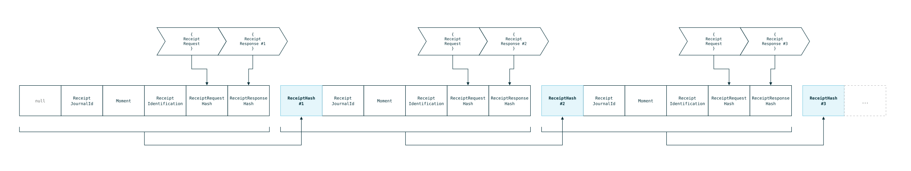
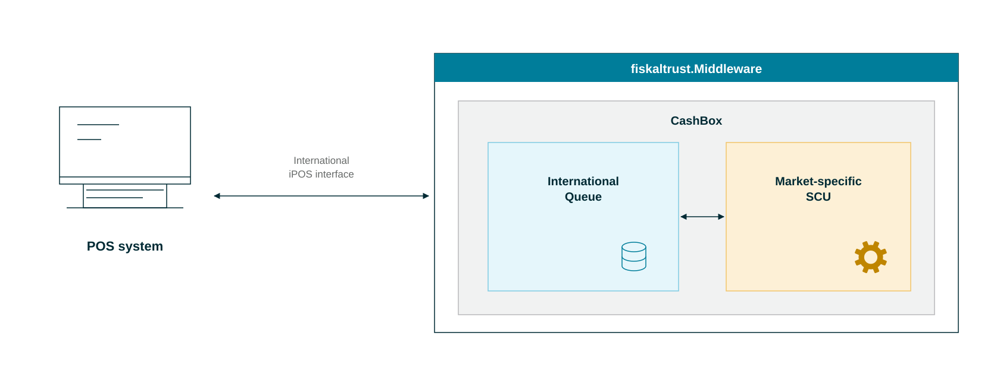

# Middleware

The fiskaltrust.Middleware is fiskaltrust's core product. It is free software that complements your POS system:

- It issues the signatures for POS receipts, using the signing mechanisms required in each country.
- It keeps track of the receipts and their signatures in its chained receipt data store.
- It provides a single, standardized communication interface for all supported countries, using REST, gRPC or SOAP.

The Middleware runs on-premise on desktop devices and Android, or off-premise as SaaS.

## Security mechanism

The fiskaltrust.Middleware processes some of the most important data fields of a receipt. It creates the receipt number, the unique identifier of each receipt that the POS system sends, to make sure that every receipt is processed.

Compliance is achieved by a combination of methods and components:

1. **Organizational security**: the fiskaltrust.Middleware makes sure that every receipt is processed by a third party in addition to the PosCreator and the PosOperator.
2. **Technical security**: each request and response is hashed to ensure the integrity of the data. To make the data immutable, a further hash value covers the whole request-response cycle: the cycle identification, the time of operation, the human-readable document number, and the hash values of the request, the response and the previous receipt. This chaining of receipt hash values makes the data immutable and reveals any change or deletion of actions sent by the POS system.

   

   *Figure 1. The receipt chaining mechanism that makes receipts immutable.*

3. **Data mirror**: to limit the risk of attacks on the chain that start from the last unlinked hash value, the Middleware mirrors the current data to the fiskaltrust cloud. The mirror detects attacks that would not be visible at the cash register.
4. **Market-specific security mechanisms**: the fiskaltrust.Middleware implements all relevant security mechanisms of each market directly, for example smart cards and online signing in Austria, and **all** TSSs in Germany.

To stay open to different platforms and operating systems, and to act as a stable interface for the POS system, the fiskaltrust.Middleware follows a strict architecture:

*Figure 2. Architecture of the fiskaltrust.Middleware.*

The configuration container, the CashBox, is identified by its unique `CashboxId` and can be integrated into various platforms and operating systems. You manage its configuration and status in the fiskaltrust.Portal of your market. The security mechanism is provided by the Queue and the SCU (signature creation unit), which implements the security requirements of the market.

## Hosted Middleware per market

Where possible, fiskaltrust offers a cloud-hosted version of the Middleware to simplify the rollout. With it, you do not install the Middleware on-site, which significantly reduces the installation effort. Select your market in the following tabs.

import Tabs from '@theme/Tabs';
import TabItem from '@theme/TabItem';
import HostedMiddlewareAT from '../../_markets/at/buy-resell/products/_hosted-middleware.mdx';
import HostedMiddlewareBE from '../../_markets/be/buy-resell/products/_hosted-middleware.mdx';
import HostedMiddlewareFR from '../../_markets/fr/buy-resell/products/_hosted-middleware.mdx';
import HostedMiddlewareDE from '../../_markets/de/buy-resell/products/_hosted-middleware.mdx';
import HostedMiddlewareGR from '../../_markets/gr/buy-resell/products/_hosted-middleware.mdx';
import HostedMiddlewareIT from '../../_markets/it/buy-resell/products/_hosted-middleware.mdx';
import HostedMiddlewarePL from '../../_markets/pl/buy-resell/products/_hosted-middleware.mdx';
import HostedMiddlewarePT from '../../_markets/pt/buy-resell/products/_hosted-middleware.mdx';
import HostedMiddlewareES from '../../_markets/es/buy-resell/products/_hosted-middleware.mdx';

<Tabs groupId="market">

  <TabItem value="AT" label="Austria">
    <HostedMiddlewareAT />
  </TabItem>

  <TabItem value="BE" label="Belgium">
    <HostedMiddlewareBE />
  </TabItem>

  <TabItem value="FR" label="France">
    <HostedMiddlewareFR />
  </TabItem>

  <TabItem value="DE" label="Germany">
    <HostedMiddlewareDE />
  </TabItem>

  <TabItem value="GR" label="Greece">
    <HostedMiddlewareGR />
  </TabItem>

  <TabItem value="IT" label="Italy">
    <HostedMiddlewareIT />
  </TabItem>

  <TabItem value="PL" label="Poland">
    <HostedMiddlewarePL />
  </TabItem>

  <TabItem value="PT" label="Portugal">
    <HostedMiddlewarePT />
  </TabItem>

  <TabItem value="ES" label="Spain">
    <HostedMiddlewareES />
  </TabItem>

</Tabs>