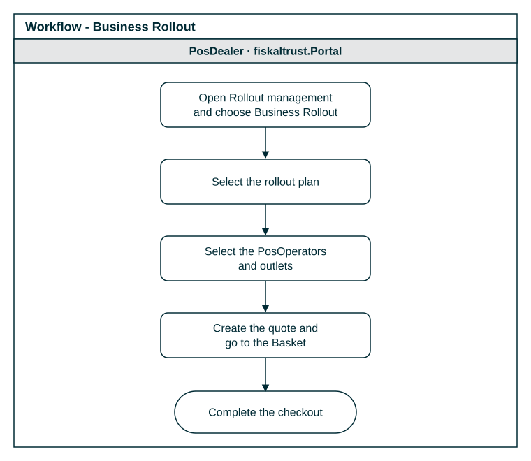

# Rollout Plans

:::info summary

After reading this, you can buy and rollout fiskaltrust products.

:::

To roll out fiskaltrust products at scale, use `Rollout management` in the fiskaltrust.Portal. It offers two types of rollout plans: the **Business Rollout** and the **Technical Rollout**. This page describes the Business Rollout.

## Business Rollout

The Business Rollout combines the purchase of entitlements, their transfer to the outlets or Queues of your PosOperators and their activation for the PosOperators in one process:

- You do not need to switch to the PosOperator's account to transfer and activate the products.
- The fiskaltrust.Portal selects the products required for the chosen rollout plan. This reduces the risk of a wrong composition of the shopping cart.
- You can roll out to several PosOperators and outlets or Queues at the same time.

*Figure 1. Workflow of a Business Rollout.*

For a step-by-step example in the Sandbox, with the rollout plan of each market, see [Business Rollout](../getting-started/my-first-cashbox.md#business-rollout) on the My First Cashbox page.

## Benefits of rollout plans

- **Save time**: you and your team create the key elements of a rollout quickly, which leaves more time to adapt each rollout to the requirements of the PosOperator.
- **Improve communication**: you define which steps your team members take in each phase of the rollout.
- **Keep track**: you identify the critical elements of each phase, and you see the current status quickly, for example when a fix is needed.
- **Support your sales**: rollout plans help you explain to your PosOperators which products you offer and why.
- **Organize your rollout**: rollout plans support a well-organized rollout strategy.

## Availability

The rollout plans available in your account are listed in `Rollout management`. They can differ between the live system and the Sandbox: the Sandbox is used to test new features with fiskaltrust and selected customers.
