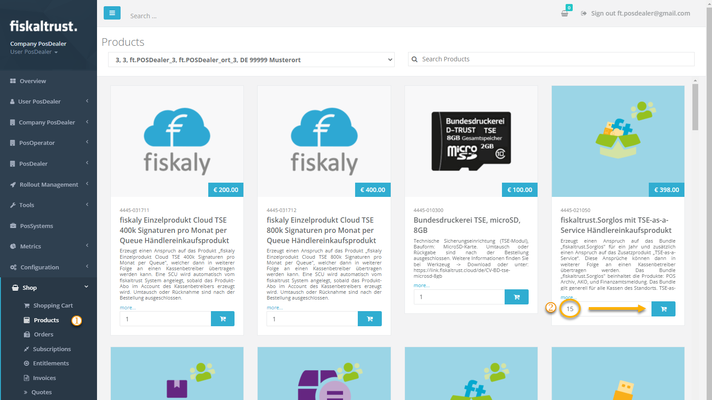
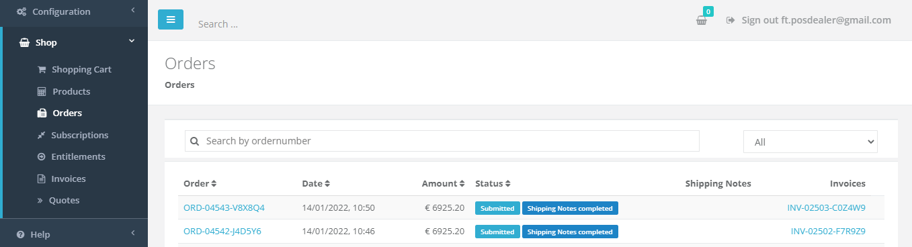
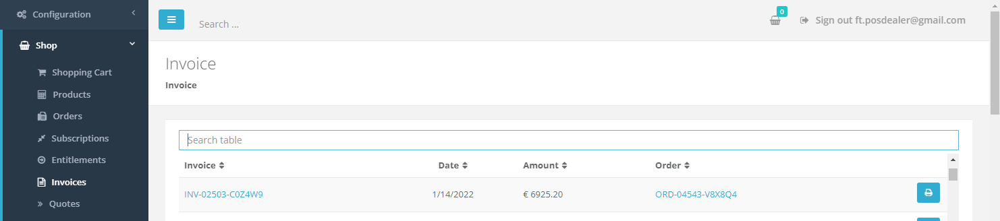
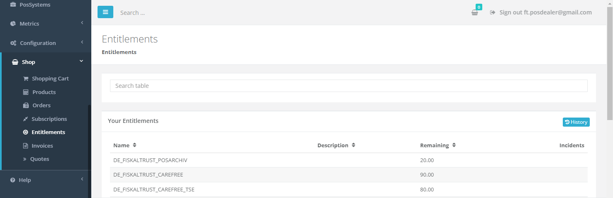

# Shop

:::info summary

After reading this, you can buy and transfer entitlements manually.

:::

The `Shop` is the basic way for PosDealers and PosOperators to buy fiskaltrust products. For the products, see [Products & Services](./products/overview.md).

:::info prerequisites

- **PosDealers**: you know how to switch to a PosOperator's account, and you have a credit limit. For larger quantities, you have signed a volume purchase agreement. For more information, see [Surrogating](../getting-started/operator-onboarding/surrogating.md) and [Overview - Buy & Resell](overview.md).
- **PosOperators**: clarify with your PosDealer whether you buy the products yourself or through your PosDealer.

:::

## Entitlements

As a PosDealer, you do not buy products directly for your PosOperators. You buy **Entitlements**: claims to the products, which you later transfer to the outlets of your PosOperators individually. You buy entitlements like other products in `Shop` > `Products`, and you find your existing entitlements in `Shop` > `Entitlements`.

## Buy products or entitlements

The following steps buy entitlements. Buying a product directly works the same way: as a PosOperator, you select an outlet, and you do not need to transfer the product afterwards.

:::tip Sandbox

To try the `Shop`, use the [Sandbox](../getting-started/sandbox.md). Orders in the Sandbox are for testing only and are free of charge. Always check that you are working in the Sandbox.

:::

1. In the Portal, open `Shop` > `Products` in the left sidebar.

   

   *Figure 1. The `Products` page in the `Shop`.*

2. If you buy a product directly as a PosOperator, open the outlet drop-down and select the outlet.
3. For each product, enter the quantity and click the shopping cart button of the product.
4. Open the `Shopping Cart` and click `Checkout`.
5. Check the products, the quantities, the prices and, if applicable, the outlet, and click `binding order`.

**Result:** The fiskaltrust.Portal shows a confirmation of your order, and you receive a copy by e-mail.

## Transfer entitlements to a PosOperator outlet

To transfer entitlements, you work in the PosOperator's account and complete the order in your own account.

<video controls src={require("./images/shop-transfer.mp4").default} width="100%" />

*Figure 2. Transferring entitlements to a PosOperator outlet.*

1. Switch to the PosOperator's account. For more information, see [Switch to a PosOperator account](../getting-started/operator-onboarding/surrogating.md#switch-to-a-posoperator-account).
2. Open `Shop` > `Products` in the left sidebar.
3. Open the outlet drop-down and select the outlet.
4. For each entitlement you want to transfer to this outlet, add the **transfer entitlement** product to the shopping cart.
5. Then, for each of these entitlements, add the **create entitlement** product to the shopping cart.
6. Click `Back to your account`.
7. Open the `Shopping Cart` and click `Checkout`.
8. Check the order, the PosOperator and the outlet, and click `binding order`. Transferring and activating existing entitlements should be free of charge.

**Result:** The fiskaltrust.Portal shows a confirmation of your order, and you receive a copy by e-mail. In `Shop` > `Entitlements`, your remaining entitlements are reduced, and the activated subscription is listed.

:::tip

- Always check that you transfer the entitlements to the right PosOperator and outlet.
- Add the **transfer entitlement** products to the shopping cart before the **create entitlement** products.
- To transfer entitlements to several outlets in one order, repeat steps 3 to 5 for each outlet, then continue with step 6.

:::

## Check orders, invoices and entitlements

### Orders

To check the status of your orders, open `Shop` > `Orders` in the left sidebar.

*Figure 3. The `Orders` page.*

### Invoices

To find the invoices of your orders, open `Shop` > `Invoices` in the left sidebar.

*Figure 4. The `Invoices` page.*

### Your entitlements

After an order is processed, the entitlements you bought are listed in `Shop` > `Entitlements`. To see the history of your purchases, click `History`. There, you can also search for an order number.

*Figure 5. The `Entitlements` page.*
