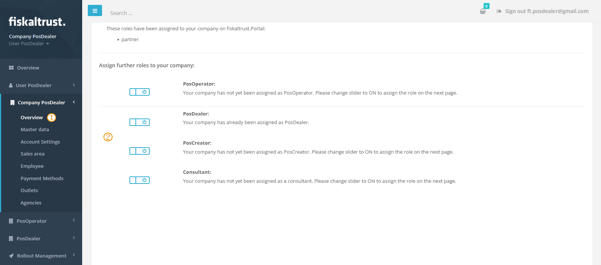
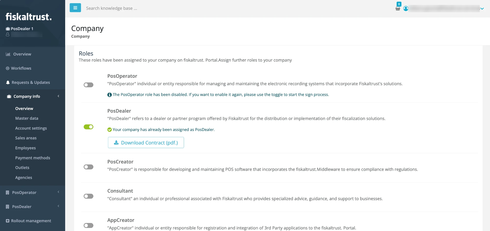
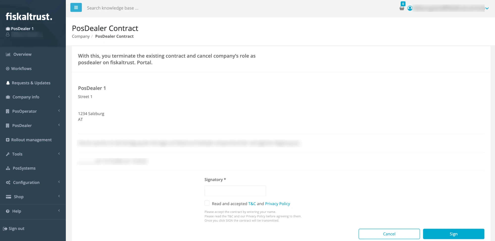

# Company Roles

:::info summary

After reading, you can activate or deactivate appropriate roles for customers and explain their effects.

:::

fiskaltrust distinguishes between four principal **company roles** in the fiskaltrust.Portal. Each role has its own audience, features and permissions. You find the roles of your company in `Company info` > `Overview`, in the `Roles` section.

*Figure 1. Overview of the principal company roles in the fiskaltrust.Portal.*

## Principal roles

|                  Role                   | Description                                                  |
| :-------------------------------------: | ------------------------------------------------------------ |
|  | **PosOperator** For **end users of POS systems** who manage their POS receipts in the context of the fiskaltrust services. They purchased the POS platform from their PosDealer and operate the POS system.  Accounts with this role use the Portal primarily to access their fiscal data and to perform maintenance steps not covered by their PosDealer. |
|  | **PosDealer** For **POS system distributors** who sell POS systems to PosOperators and support and maintain these setups.  Accounts with this role use the Portal primarily to act on behalf of their PosOperators. The PosDealer role includes invitation management, a credit limit, rollouts of CashBox setups and maintenance for PosOperators. |
|  | **PosDealer auto-invitation (opt-in)** (Germany and Italy only) An **optional add-on** to the PosDealer role for POS system distributors who want to automate the onboarding of their PosOperators as much as possible.  Accounts with this role get an extended onboarding user interface. It allows them to fully and legally activate a PosOperator's account by signing the PosOperator's partner contracts as a representative, instead of sending a regular invitation that the PosOperator must accept first.  The slider is only shown when the PosDealer role is active. **This role may require particular attention to legal aspects on your side.** |
|  | **PosCreator** For **manufacturers who develop POS systems**. PosCreators are not involved in the rollout at PosOperators; they focus on the technical integration of the Middleware.  PosCreators use the Portal primarily to enter their POS systems and to invite PosDealers to use them. In addition to the business areas and properties of the POS system, the Portal creates a `PosSystemId` as a unique identifier.  **The `PosSystemId` is currently not mandatory in every country, but its use in the fiskaltrust.Portal is crucial for our compliance service.** |
|  | **Consultant** For **tax consultants** who advise PosOperators on related topics.  Accounts with this role use the Portal primarily to access the fiscal data of associated and authorized PosOperator accounts. |

*Table 1. Principal company roles.*

## Additional roles

Depending on the market and the features enabled for your account, the `Roles` section can show further roles.

| Role | Shown in | Description |
| ---- | -------- | ----------- |
| **AppCreator** | Accounts with the AppCreator feature enabled | For individuals or entities that register and integrate third-party applications in the fiskaltrust.Portal. |
| **PosOperatorOptInIVAServizi** | Italy | For PosOperators who manage the provision of access credentials or delegation. To deactivate the PosOperator role, deactivate this role first. |

*Table 2. Additional roles shown depending on market and enabled features.*

:::caution

You can select more than one role. **Only pick the roles that apply to your business case**, because each role entails different contractual requirements and obligations.

:::

## Prerequisites

- Your user has the permission to conclude contracts for the company. Without it, the role sliders are disabled.
- If **PosOperator** is the only principal role of your company, you cannot activate PosDealer, PosCreator, Consultant or AppCreator. The Portal shows the tooltip "When PosOperator role is enabled, you can't sign any other roles."

## How to activate a role

*Figure 2. Company overview page in the fiskaltrust.Portal used to activate a role.*

|             Step             | Description                                                  |
| :--------------------------: | ------------------------------------------------------------ |
|  | In the left-hand navigation, open `Company info` > `Overview`. |
|  | In the `Roles` section, **switch on the slider** of the role you want to activate: from  to . |

*Table 3. Steps to activate a role.*

The Portal opens the agreement page of the role.

*Figure 3. Agreement page shown after switching on a role.*

|             Step             | Description                                                  |
| :--------------------------: | ------------------------------------------------------------ |
|  | Read the **agreement**. |
|  | Enter your **legal name** in the `Signatory` field at the bottom of the page. |
|  | Select the checkbox `Read and accepted T&C and Privacy Policy`. |
|  | Click `Sign`. |

*Table 4. Steps to sign the role agreement.*

**Result:** The role is active for your account. You receive an email confirming the activation of the role. In the `Roles` section, you can download the signed contract with `Download Contract`.

## How to deactivate a role

*Figure 4. Company overview page used to deactivate a role.*

|             Step             | Description                                                  |
| :--------------------------: | ------------------------------------------------------------ |
|  | In the left-hand navigation, open `Company info` > `Overview`. |
|  | In the `Roles` section, **switch off the slider** of the role you want to deactivate: from  to . |

*Table 5. Steps to deactivate a role.*

The Portal opens the confirmation page for the termination of the role contract.

*Figure 5. Confirmation page shown when deactivating a role.*

|             Step             | Description                                                  |
| :--------------------------: | ------------------------------------------------------------ |
|  | Enter your **legal name** in the `Signatory` field at the bottom of the page. |
|  | Click `Sign`. |

*Table 6. Steps to confirm the role deactivation.*

**Result:** The role is inactive for your account. You receive an email confirming the deactivation of the role. To activate the role again, switch on its slider and sign the agreement again.
