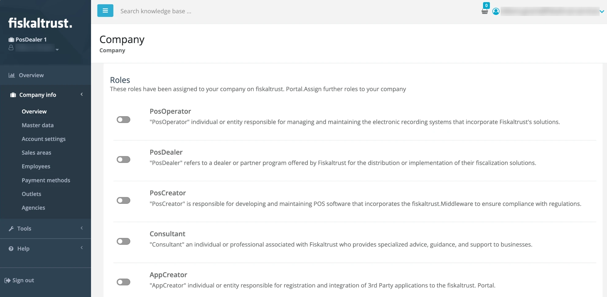
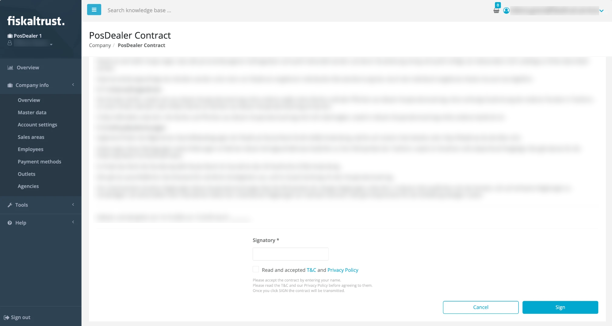

# Company Roles

:::info summary

After reading, you can activate or deactivate appropriate roles for customers and explain their effects.

:::

fiskaltrust distinguishes between five principal **company roles** in the fiskaltrust.Portal. Each role has its own audience, features and permissions. You find the roles of your company in `Company info` > `Overview`, in the `Roles` section.

*Figure 1. The `Roles` section in `Company info` > `Overview`.*

## Principal roles

| Role | Description |
| ---- | ----------- |
| **PosOperator** | For **end users of POS systems** who manage their POS receipts in the context of the fiskaltrust services. They purchased the POS platform from their PosDealer and operate the POS system.  Accounts with this role use the Portal primarily to access their fiscal data and to perform maintenance steps not covered by their PosDealer. |
| **PosDealer** | For **POS system distributors** who sell POS systems to PosOperators and support and maintain these setups.  Accounts with this role use the Portal primarily to act on behalf of their PosOperators. The PosDealer role includes invitation management, a credit limit, rollouts of CashBox setups and maintenance for PosOperators. |
| **PosCreator** | For **manufacturers who develop POS systems**. PosCreators are not involved in the rollout at PosOperators; they focus on the technical integration of the Middleware.  PosCreators use the Portal primarily to enter their POS systems and to invite PosDealers to use them. In addition to the business areas and properties of the POS system, the Portal creates a `PosSystemId` as a unique identifier.  **The `PosSystemId` is currently not mandatory in every country, but its use in the fiskaltrust.Portal is crucial for our compliance service.** |
| **Consultant** | For **tax consultants** who advise PosOperators on related topics.  Accounts with this role use the Portal primarily to access the fiscal data of associated and authorized PosOperator accounts. |
| **AppCreator** | For individuals or entities that register and integrate third-party applications in the fiskaltrust.Portal. |

*Table 1. Principal company roles.*

## Additional roles

Depending on the market, the `Roles` section can show further roles.

| Role | Shown in | Description |
| ---- | -------- | ----------- |
| **PosDealer auto-invitation (opt-in)** | Germany and Italy | An **optional add-on** to the PosDealer role for POS system distributors who want to automate the onboarding of their PosOperators as much as possible.  Accounts with this role get an extended onboarding user interface. It allows them to fully and legally activate a PosOperator's account by signing the PosOperator's partner contracts as a representative, instead of sending a regular invitation that the PosOperator must accept first.  The toggle is only shown when the PosDealer role is active. **This role may require particular attention to legal aspects on your side.** |
| **PosDealer for RKSV Sign** | Austria | Adds the capability to manage RKSV.Sign products in the account. RKSV.Sign is a sign-only product in Austria that replaces HSMs and smart cards in existing implementations for POS systems where the Middleware cannot be used. |
| **PosOperatorOptInIVAServizi** | Italy | For PosOperators who manage the provision of access credentials or delegation. To deactivate the PosOperator role, deactivate this role first. |

*Table 2. Additional roles shown depending on the market.*

:::caution

You can select more than one role. **Only pick the roles that apply to your business case**, because each role entails different contractual requirements and obligations.

:::

## Prerequisites

- Your user has the `Contract conclusion` authorization. Without it, the role toggles are disabled. For more information, see [Manage user rights](registration.md#manage-user-rights).
- If **PosOperator** is the only principal role of your company, you cannot activate PosDealer, PosCreator, Consultant or AppCreator. The Portal shows the tooltip "When PosOperator role is enabled, you can't sign any other roles."

## Activate a role

1. In the left-hand navigation, open `Company info` > `Overview`.
2. In the `Roles` section, **turn on the toggle** of the role you want to activate: from <em></em> to <em></em>. The Portal opens the agreement page of the role.

   

   *Figure 2. The `Roles` section with all role toggles turned off.*

3. Read the **agreement**.
4. Enter your **legal name** in the `Signatory` field at the bottom of the page.
5. Select the checkbox `Read and accepted T&C and Privacy Policy`.
6. Click `Sign`.

   

   *Figure 3. Agreement page of a role, here the `PosDealer Contract`, with the `Signatory` field and the `Sign` button.*

**Result:** The role is active for your account. You receive an email confirming the activation of the role. In the `Roles` section, you can download the signed contract with `Download Contract (pdf.)`.

## Deactivate a role

1. In the left-hand navigation, open `Company info` > `Overview`.
2. In the `Roles` section, **turn off the toggle** of the role you want to deactivate: from <em></em> to <em></em>. The Portal opens the confirmation page for the termination of the role contract.

   

   *Figure 4. The `Roles` section with the active PosDealer role and its `Download Contract (pdf.)` button.*

3. Enter your **legal name** in the `Signatory` field at the bottom of the page.
4. Select the checkbox `Read and accepted T&C and Privacy Policy`.
5. Click `Sign`.

   

   *Figure 5. Termination page of a role, here for the PosDealer role, with the `Signatory` field and the `Sign` button.*

**Result:** The role is inactive for your account. You receive an email confirming the deactivation of the role. To activate the role again, turn on its toggle and sign the agreement again.
