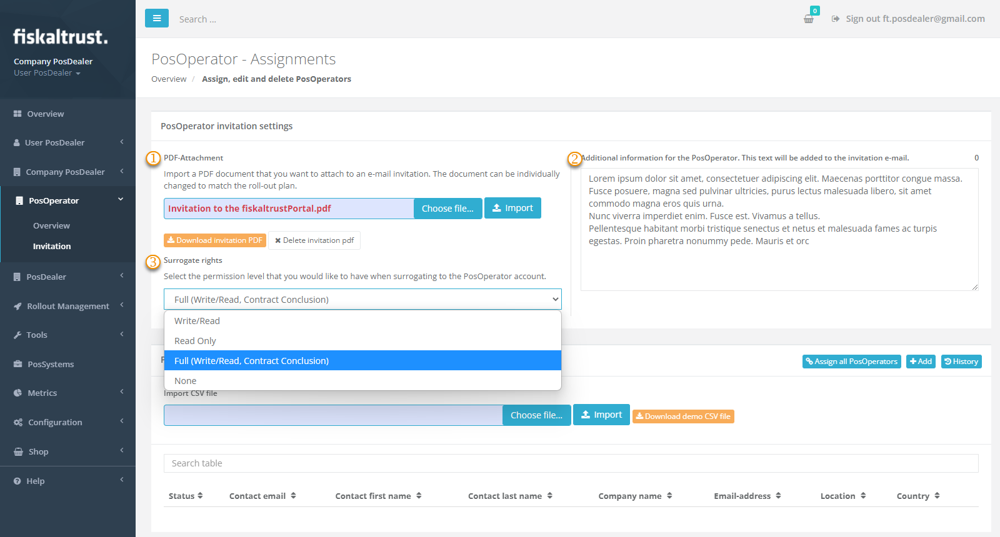
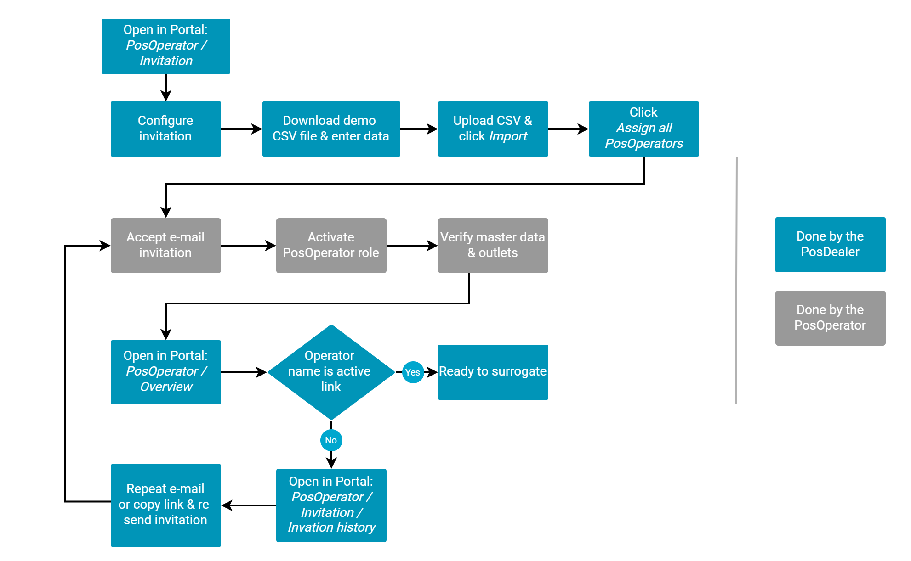
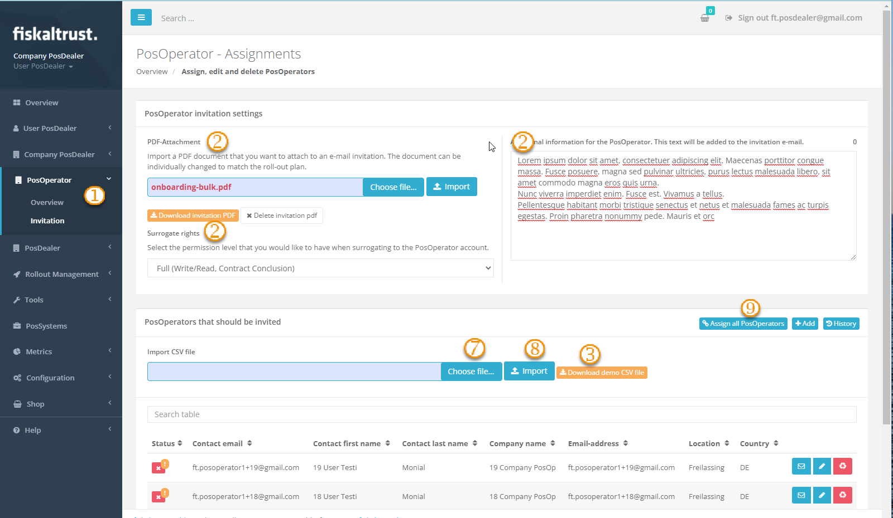
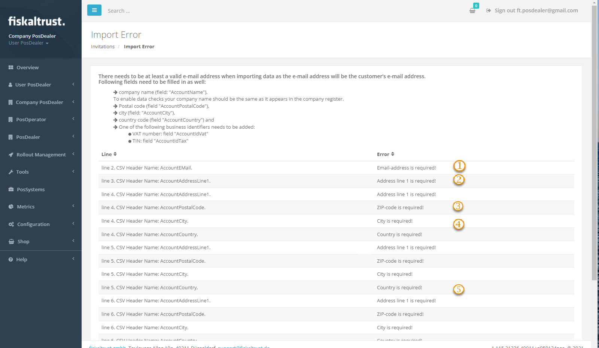
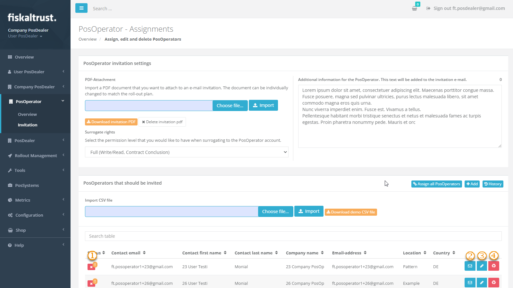
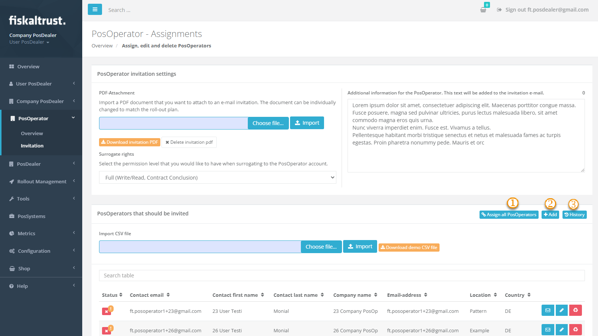
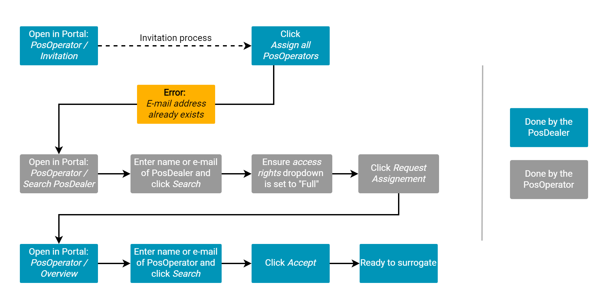
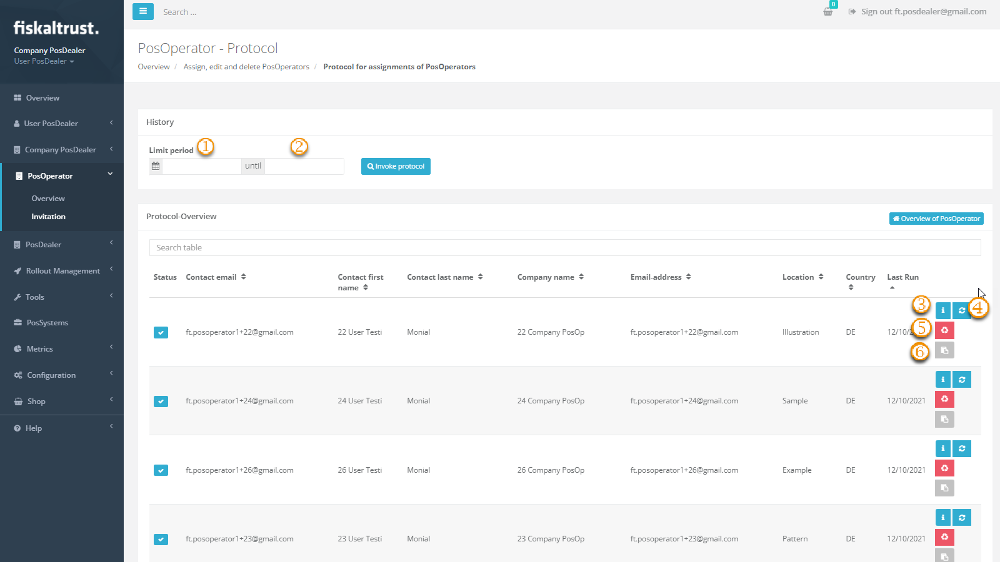

# Invitation process

:::info summary
After reading this, you can invite a single PosOperator and invite several PosOperators at once with a CSV file.
:::

A PosCreator invites you, as a PosDealer, to the fiskaltrust.Portal. You invite your PosOperators. Once a PosOperator has an account in the fiskaltrust.Portal, you can transfer fiskaltrust products that you purchased in the Portal shop to that account. For more information, see [Business Model](../../business-basics/business-model.md).

There are two ways to invite PosOperators:

| Way | Use it for |
|-----|------------|
| [Invitation of a single PosOperator](#invitation-of-a-single-posoperator) | One PosOperator, for example a new contact, on-site support, or testing in the sandbox. |
| [Bulk invitation of PosOperators](#bulk-invitation-of-posoperators) | Several PosOperators at once, imported from a CSV file. |

*Table 1. Ways to invite PosOperators.*

:::warning E-mail addresses cannot be deleted
You cannot delete an e-mail address entirely in the fiskaltrust.Portal, so you cannot transfer an e-mail address that was used once to any other account. Test the invitation process in the sandbox first to avoid problems with e-mail addresses in the production system.
:::

## Prerequisites

- Your account has the PosDealer role. Only PosDealers can invite PosOperators; PosCreators and consultants cannot. Both can additionally activate the PosDealer role to get these options in the fiskaltrust.Portal. For more information, see [Company Roles](../company-roles.md).
- You have checked the invitation settings as described in [Preparation of invitations](#preparation-of-invitations).

## Preparation of invitations

Check the invitation settings before you invite PosOperators, regardless of which way you use.

1. Choose `PosDealer` > `PosOperators` to see the PosOperators already assigned to your account.
2. Choose `PosDealer` > `Invitation`. In Austria, Germany and France, `PosOperator` > `Invitation` opens the same page.
3. In `PosOperator invitation settings`, check or change the settings described in Table 2.
4. Continue with [Invitation of a single PosOperator](#invitation-of-a-single-posoperator) or [Bulk invitation of PosOperators](#bulk-invitation-of-posoperators).

*Figure 1. PosOperator invitation settings in the fiskaltrust.Portal.*

| Setting | Description |
|:-------:|-------------|
|| `PDF-Attachment`: Attach a document to the e-mail invitation. Use it as an accompanying letter that explains that you, as a PosDealer, are extending your offers and invite your PosOperators to register with the fiskaltrust.Portal via the confirmation link. This avoids confusion when PosOperators receive an e-mail from an unknown sender such as sandbox@fiskaltrust.TLD or robot@fiskaltrust.TLD. Select the PDF file with `Choose file` and upload it with `Import`. After the upload, `Download invitation pdf` and `Delete invitation pdf` are available. |
|| `Additional information for the PosOperator. This text will be added to the invitation e-mail.`: Add your own text of up to 1000 characters to the automated e-mail invitation (see [Preview of the e-mail invitation](#preview-of-the-e-mail-invitation)). Use it to inform your PosOperators personally, for the same reason as the PDF attachment. The counter next to the field shows the remaining characters. The text is saved when you leave the field. |
|| `Surrogate rights`: The permission level you get when you switch to the PosOperator's account (surrogating). The options are `Full (Write/Read, Contract Conclusion)` (default), `Write/Read`, `Read Only` and `None`. Select `Full (Write/Read, Contract Conclusion)`. With any other option you can access the PosOperator's account, but you cannot conclude contracts on the PosOperator's behalf, which is necessary for cooperation with third parties. For more information, see [Surrogating](surrogating.md). |

*Table 2. Invitation settings.*

## Invitation of a single PosOperator

Invite a single PosOperator, for example, when you give on-site support to a PosOperator who wants to use the fiskaltrust services immediately when a POS system is put into operation, or when you test the fiskaltrust.Portal and its processes in the sandbox.

Depending on the country, when a PosOperator is registered for the first time, further master data can be retrieved from the relevant authority and checked by entering a tax number.

*Figure 2. Process of inviting a single PosOperator.*

### Steps

1. Choose `PosDealer` > `Invitation`.
2. Check the settings as described in [Preparation of invitations](#preparation-of-invitations).
3. Choose `Add`.
4. Fill in the mandatory fields. They are required so that the PosOperator can be found and assigned correctly in the fiskaltrust.Portal via the e-mail address:
   - `Company data`: company name, e-mail address, address line 1, postal code, city, country
   - `User data`: first name, last name, contact e-mail address
5. Fill in the tax identification numbers. They are not mandatory for the invitation, but they and their validation are **essential** for the correct management of the cash register systems (for example AccountIdVat, AccountIdGln, AccountUStIdNr).
6. Choose `Save`. The PosOperator is added to the list `PosOperators that should be invited`.
7. Choose `Invite all PosOperators` to send the e-mail invitation.

If the invitation does not reach the PosOperator, see [Managing the invitations](#managing-the-invitations).

### Preview of the e-mail invitation

import Tabs from '@theme/Tabs';
import TabItem from '@theme/TabItem';
import PreviewAT from '../../_markets/at/getting-started/operator-onboarding/invitation-process/_preview-email.mdx';
import PreviewBE from '../../_markets/be/getting-started/operator-onboarding/invitation-process/_preview-email.mdx';
import PreviewFR from '../../_markets/fr/getting-started/operator-onboarding/invitation-process/_preview-email.mdx';
import PreviewDE from '../../_markets/de/getting-started/operator-onboarding/invitation-process/_preview-email.mdx';
import PreviewGR from '../../_markets/gr/getting-started/operator-onboarding/invitation-process/_preview-email.mdx';
import PreviewIT from '../../_markets/it/getting-started/operator-onboarding/invitation-process/_preview-email.mdx';
import PreviewPL from '../../_markets/pl/getting-started/operator-onboarding/invitation-process/_preview-email.mdx';
import PreviewPT from '../../_markets/pt/getting-started/operator-onboarding/invitation-process/_preview-email.mdx';
import PreviewES from '../../_markets/es/getting-started/operator-onboarding/invitation-process/_preview-email.mdx';

<Tabs groupId="market">

  <TabItem value="AT" label="Austria">
    <PreviewAT />
  </TabItem>

  <TabItem value="BE" label="Belgium">
    <PreviewBE />
  </TabItem>

  <TabItem value="FR" label="France">
    <PreviewFR />
  </TabItem>

  <TabItem value="DE" label="Germany">
    <PreviewDE />
  </TabItem>

  <TabItem value="GR" label="Greece">
    <PreviewGR />
  </TabItem>

  <TabItem value="IT" label="Italy">
    <PreviewIT />
  </TabItem>

  <TabItem value="PL" label="Poland">
    <PreviewPL />
  </TabItem>

  <TabItem value="PT" label="Portugal">
    <PreviewPT />
  </TabItem>

  <TabItem value="ES" label="Spain">
    <PreviewES />
  </TabItem>

</Tabs>

## Bulk invitation of PosOperators

Import a CSV file to invite many business partners at once. The fiskaltrust.Portal creates and sends the invitations automatically, so the data of your business partners must be correct. Check the [preparation](#preparation-of-invitations) first, so that invitations are not mistakenly treated as spam. The fiskaltrust.Portal provides a demo CSV file with the required structure; the columns are described in [Fields of the CSV file](#fields-of-the-csv-file).

*Figure 3. Process of the bulk invitation of PosOperators.*

### Steps

*Figure 4. Bulk invitation via CSV file in the fiskaltrust.Portal.*

| Step | Description |
|:----:|-------------|
| |Choose `PosDealer` > `Invitation`. |
| |Check the settings as described in [Preparation of invitations](#preparation-of-invitations). |
| |Choose `Download demo CSV file`. |
| |Open the demo CSV file. |
| |Add the data of the PosOperators as described in [Fields of the CSV file](#fields-of-the-csv-file) and save the file as a CSV file. |
| |Go back to the fiskaltrust.Portal and choose `PosDealer` > `Invitation`. |
| |In `PosOperators that should be invited`, under `Import CSV file`, select your CSV file with `Choose file`. |
| |Choose `Import`. The data is uploaded and checked for duplicate or incomplete records. You can check and complete each record. If records are incomplete, the import error page opens (see [Handling error messages](#handling-error-messages)). |
| |Choose `Invite all PosOperators` to send the e-mail invitation to each business partner in your CSV file. For a preview of the e-mail, see [Preview of the e-mail invitation](#preview-of-the-e-mail-invitation). |

*Table 3. Steps of the bulk invitation, shown in Figure 4.*

### Fields of the CSV file

import FieldsAT from '../../_markets/at/getting-started/operator-onboarding/invitation-process/_fields-details.mdx';
import FieldsBE from '../../_markets/be/getting-started/operator-onboarding/invitation-process/_fields-details.mdx';
import FieldsFR from '../../_markets/fr/getting-started/operator-onboarding/invitation-process/_fields-details.mdx';
import FieldsDE from '../../_markets/de/getting-started/operator-onboarding/invitation-process/_fields-details.mdx';
import FieldsGR from '../../_markets/gr/getting-started/operator-onboarding/invitation-process/_fields-details.mdx';
import FieldsIT from '../../_markets/it/getting-started/operator-onboarding/invitation-process/_fields-details.mdx';
import FieldsPL from '../../_markets/pl/getting-started/operator-onboarding/invitation-process/_fields-details.mdx';
import FieldsPT from '../../_markets/pt/getting-started/operator-onboarding/invitation-process/_fields-details.mdx';
import FieldsES from '../../_markets/es/getting-started/operator-onboarding/invitation-process/_fields-details.mdx';

<Tabs groupId="market">

  <TabItem value="AT" label="Austria">
    <FieldsAT />
  </TabItem>

  <TabItem value="BE" label="Belgium">
    <FieldsBE />
  </TabItem>

  <TabItem value="FR" label="France">
    <FieldsFR />
  </TabItem>

  <TabItem value="DE" label="Germany">
    <FieldsDE />
  </TabItem>

  <TabItem value="GR" label="Greece">
    <FieldsGR />
  </TabItem>

  <TabItem value="IT" label="Italy">
    <FieldsIT />
  </TabItem>

  <TabItem value="PL" label="Poland">
    <FieldsPL />
  </TabItem>

  <TabItem value="PT" label="Portugal">
    <FieldsPT />
  </TabItem>

  <TabItem value="ES" label="Spain">
    <FieldsES />
  </TabItem>

</Tabs>

### Handling error messages

If mandatory fields in the CSV file are empty or wrong, the import error page lists each error with its line (`Line`) and message (`Error`).

1. Note the error messages.
2. Add the missing data in the respective lines of the CSV file.
3. Choose `Back` and import the corrected file again.

*Figure 5. Import error messages after uploading an incomplete CSV file.*

| Message | Description |
|:-------:|-------------|
| |`Email-address is required!` |
| |`Address line 1 is required!` |
| |`ZIP-code is required!` |
| |`City is required!` |
| |`Country is required!` |

*Table 4. Import error messages for missing mandatory CSV fields.*

## Managing the invitations

If the preparation is complete, the invitation process runs automatically. If problems arise, you can fix most of them yourself. For example, if a PosOperator says that no e-mail invitation arrived, check the invitation history.

### Troubleshooting

#### Status and error messages

*Figure 6. Invitation list with invitation status and row actions.*

| Step | Description |
|:----:|-------------|
| |Check the `Status` of the invitation: `Invitation Sent`, `Press "Send" to invite PosOperator` (not sent yet), or `Failed sending` (red symbol; hover over it to see the reason). |
| |Choose `Send Invitation to this PosOperator` (envelope icon) to send this single e-mail invitation, or `Invite all PosOperators` to send all. For an invitation that was already sent, the row shows `Resend invitation to this PosOperator` instead. |
| |If the invitation cannot be assigned to your account because the PosOperator's data is incorrect or incomplete, choose `Edit` to correct it. |
| |Choose `Delete` to remove the data of a PosOperator who is not yet assigned. |
| |If `This E-Mail address already exists` appears, see [Onboarding of existing PosOperators](#onboarding-of-existing-posoperators). |

*Table 5. Checking the invitation status and handling error messages.*

#### Assigning PosOperators in a bulk process

*Figure 7. Buttons for assigning PosOperators in a bulk process.*

| Button | Description |
|:------:|-------------|
| |`Invite all PosOperators`: sends the e-mail invitation to **all** PosOperators in the list who have not yet been invited. |
| |`Add`: adds a single PosOperator manually. For more information, see [Invitation of a single PosOperator](#invitation-of-a-single-posoperator). |
| |`History`: opens the invitation history to check or repair e-mail invitations (see [Options with invited PosOperators](#options-with-invited-posoperators)). |

*Table 6. Buttons for assigning PosOperators in a bulk process.*

#### Onboarding of existing PosOperators

If the message `This E-Mail address already exists` appears, another PosDealer has already onboarded the PosOperator. In this case, the PosOperator requests the assignment to your account.

:::warning
**Do not, under any circumstances, invite this PosOperator again using a different e-mail address.** This causes problems when verifying the business identifications used to authenticate with tax authorities or third-party services.
:::

*Figure 8. Onboarding a PosOperator who already has an account.*

| Step | Description |
|:----:|-------------|
| |You choose `Invite all PosOperators` (`PosDealer` > `Invitation`) and get the message `This E-Mail address already exists`. |
| |Do not invite this PosOperator again with a different e-mail address. |
| |Ask the PosOperator to add your account as a new or further PosDealer. |
| |The PosOperator opens the fiskaltrust.Portal and chooses `PosOperator` > `Search dealer/consultant`. |
| |The PosOperator searches for your account, for example by name or e-mail address. |
| |After checking name, e-mail address and access rights, the PosOperator chooses `Request assignment – dealer`. |
| |You choose `PosDealer` > `PosOperators`, find the new PosOperator and choose `Accept`. The PosOperator's name becomes an active link that you can use for surrogating. |

*Table 7. Steps to onboard a PosOperator who already has an account.*

#### Options with invited PosOperators

Choose `PosDealer` > `Invitation` > `History` to open the invitation history.

*Figure 9. Invitation history.*

| Option | Description |
|:------:|-------------|
| |Start date: restricts the history to invitations from this date. |
| |End date (after `until`): restricts the history to invitations up to this date. Without dates, the whole history is shown. To narrow down the list further, enter text in the search field (`Search...`); clear the field to see all entries again. |
| |`Details`: shows the data of the invitation. |
| |`Send invitation again`: resends the e-mail invitation for this record. |
| |Delete the record. You cannot delete an e-mail address entirely in the fiskaltrust.Portal, so you cannot transfer an e-mail address that was used once to any other account. |
| |`Copy link to Clipboard`: shows the direct invitation link. Copy it and send it to your PosOperator by direct message. |

*Table 8. Options in the invitation history.*

To return to the invitation page, choose `Overview of PosOperator`.
