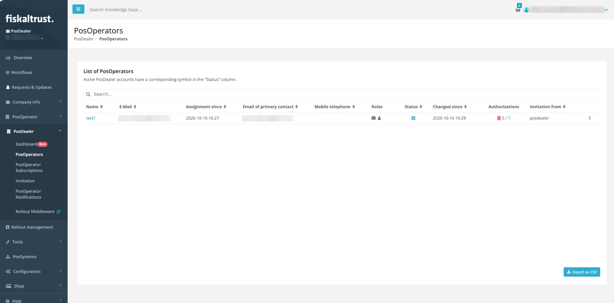
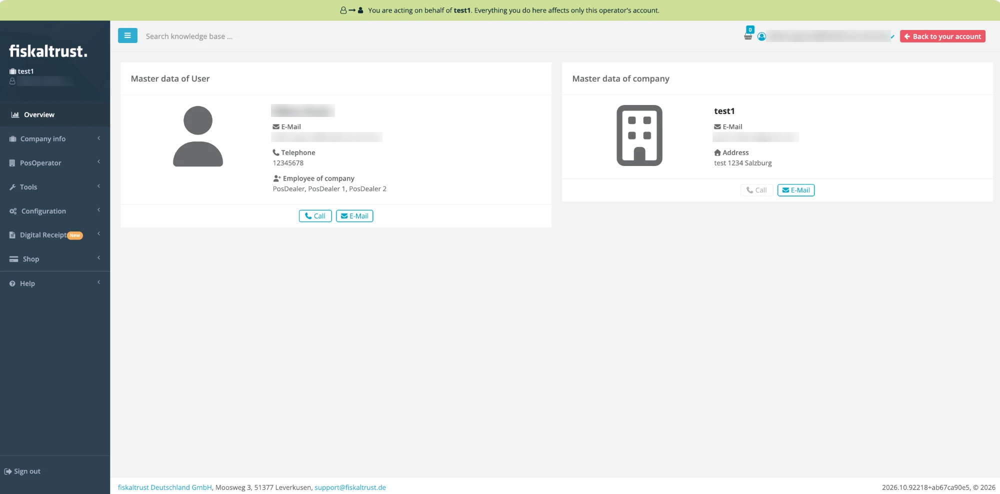
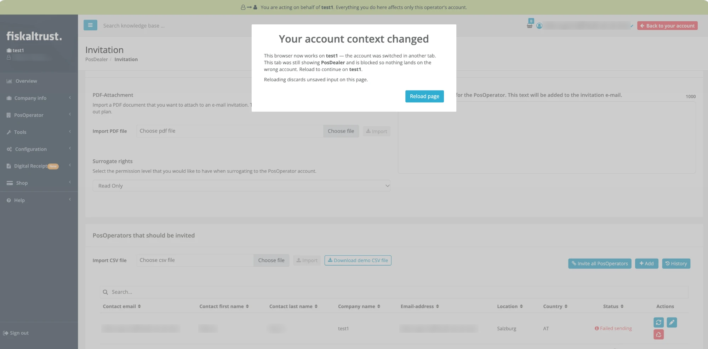
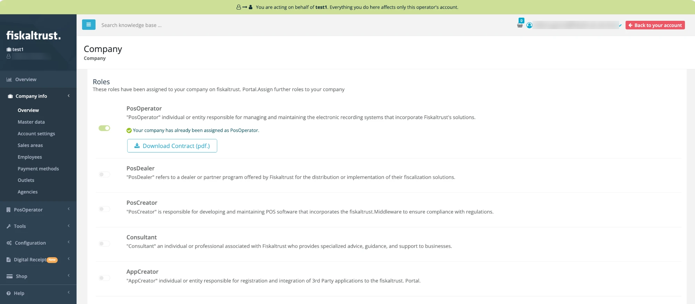
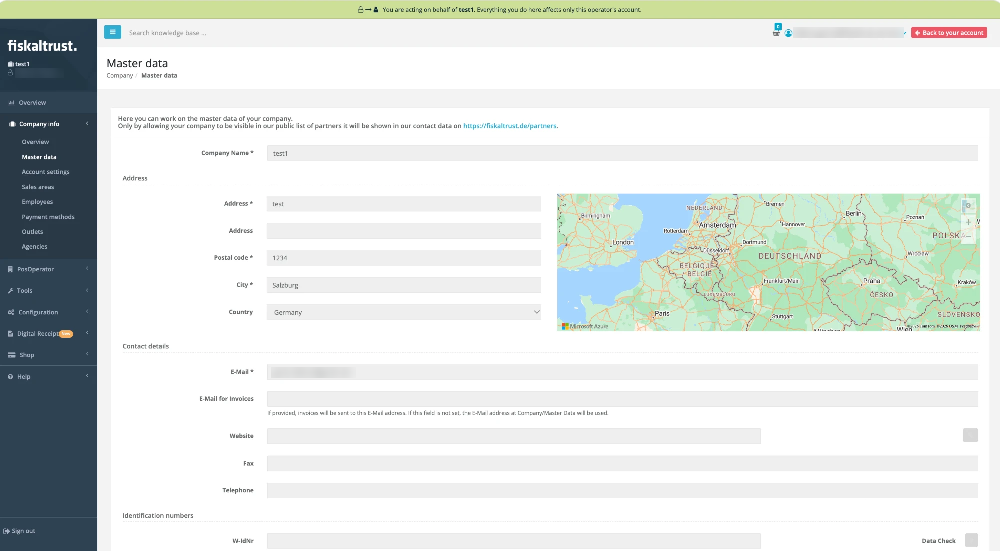

# Surrogating

:::info summary
After reading this, you can explain the prerequisites for acting on behalf of a PosOperator in the fiskaltrust.Portal, and you can do it.
:::

fiskaltrust distinguishes company roles in the fiskaltrust.Portal. The end users of POS systems activate the role contract of a **PosOperator**; distributors of POS systems activate the role contract of a **PosDealer**. For more information, see [Company Roles](../company-roles.md).

To support and maintain a PosOperator's POS system, you, as a PosDealer, switch from your account to the PosOperator's account, change settings, assign contracts or order products, and switch back to your account. This is called **surrogating**.

Surrogating always works with your account and one PosOperator account; there is no bulk action. This page uses checking a PosOperator's master data as the example.

## Prerequisites

1. Your PosDealer account is set up and ready to use.
2. You have configured the invitation settings as described in [Prepare the invitations](invitation-process.md#prepare-the-invitations). The `Surrogate rights` setting defines your permission level in the PosOperator's account.
3. The PosOperator has accepted the invitation by activating the role contract.
4. There have been no changes to other role contracts or to your authorizations.
5. The PosOperator's account is active. To check, open `PosDealer` > `PosOperators` in the left sidebar of the Portal:
   - If the PosOperator's name is an active link, the account is active.
   - If the PosOperator's name is not an active link, your invitation has not been accepted yet. Follow the instructions in [Manage the invitations](invitation-process.md#manage-the-invitations).

:::tip
To get an overview of active and inactive PosOperator accounts, for example to contact them, open `PosDealer` > `PosOperators` in the left sidebar of the Portal and click `Export as CSV`.
:::

## Switch to a PosOperator account

*Figure 1. The `PosOperators` page with the list of PosOperators.*

1. In the Portal, open `PosDealer` > `PosOperators` in the left sidebar.
2. Enter the name or e-mail address of the PosOperator in the `Search...` field. The list shows the PosOperators whose name or e-mail address matches the search term. Without a search term, all PosOperators are shown.
3. Click the name of the PosOperator to switch to the PosOperator's account. Only the names of active accounts are links.

## Work in the PosOperator account

While you act on behalf of a PosOperator, a banner is shown on every page of the fiskaltrust.Portal. It names the PosOperator, so you always know whose account your actions affect.

1. Check that you are in the right account. The banner `You are acting on behalf of` shows the PosOperator's name, and the sidebar header shows the PosOperator's company name.

   

   *Figure 2. The fiskaltrust.Portal while you act on behalf of a PosOperator.*

2. Work in the account as in your own account. Everything you do affects only the PosOperator's account. You act with your own user, so your user name and e-mail address are still displayed.
3. If you buy products in the shop, they are added to the **shopping cart**. The shopping cart is still available after you switch back to your account.
4. To switch back to your account, click `Back to your account`. The banner disappears.

   :::warning
   Do not leave the PosOperator's account with `Sign out`, because your **shopping cart** would be lost.
   :::

### Work in several browser tabs

Only one account can be active per browser. If you switch to another account in one browser tab, for example to a PosOperator's account or back to your account, all other open fiskaltrust.Portal tabs are blocked with the message `Your account context changed`. The message names both accounts: the one the tab was showing and the one the browser now works on.

*Figure 3. The message in a tab that still showed the previous account.*

To continue in a blocked tab, do one of the following:

- Click `Reload page`. The tab opens the dashboard of the now-active account. Reloading discards unsaved input on the page.
- Switch back to the previous account in the other tab. The message disappears, and you can keep working.

:::info
If a different user signed in on the same browser, the message also offers `Sign out`. For more information, see [Clear Warning When Your Account Context Changes in Another Tab](https://docs.fiskaltrust.eu/changelog/portal/account-context-warning).
:::

## Check the PosOperator's master data

PosOperators follow these steps in their own account after signing in. PosDealers follow them after switching to the PosOperator's account.

1. In the Portal, open `Company info` > `Overview` in the left sidebar.
2. In `Roles`, check that the `PosOperator` toggle, and no other role toggle, is turned on. If another role is turned on, deactivate it. For more information, see [Deactivate a role](../company-roles.md#deactivate-a-role).

   

   *Figure 4. The `Roles` section of a PosOperator account with only the `PosOperator` role.*

3. Open `Company info` > `Master data` in the left sidebar.

   

   *Figure 5. The `Master data` page of a PosOperator account.*

4. Check the fields in `Address` and `Contact details`. Optionally, enter a dedicated e-mail address for invoices in `E-Mail for Invoices`. If this field is empty, invoices are sent to the address in `E-Mail`.
5. In `Identification numbers`, check that the tax identification numbers are complete. They are not mandatory for the invitation process, but they are the basis for correct cash register management and a prerequisite for using third-party services.
6. Click `Data Check` to validate the values. Save your changes before you leave the page.
7. Open `Company info` > `Outlets` in the left sidebar and check the outlets for completeness and correctness. For more information, see [Master data](master-data.md).
8. When you have finished:
   - PosDealers: click `Back to your account` to return to your account and check the accounts of other PosOperators.
   - PosOperators: click `Sign out`.

:::caution No access to employee data for PosDealers
For data privacy reasons, you cannot manage the PosOperator's employee data in the fiskaltrust.Portal when you have switched to a PosOperator account as a PosDealer.
:::
