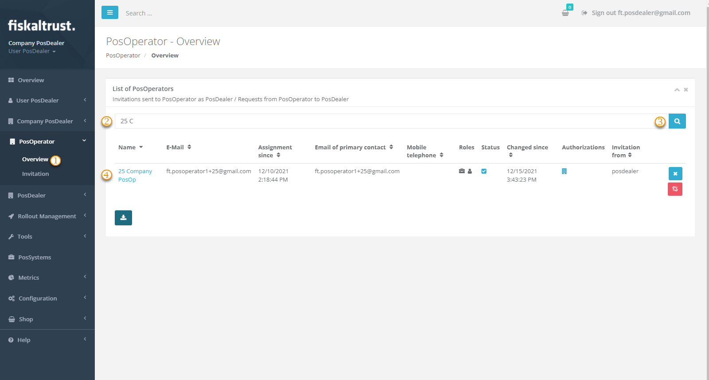
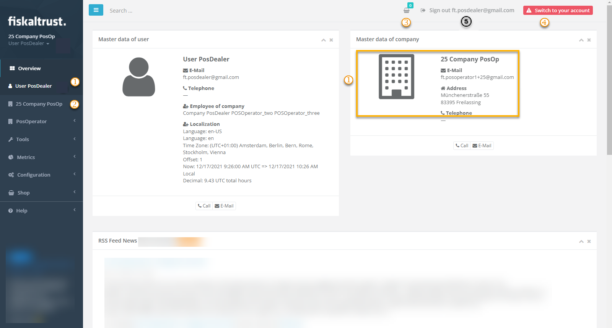
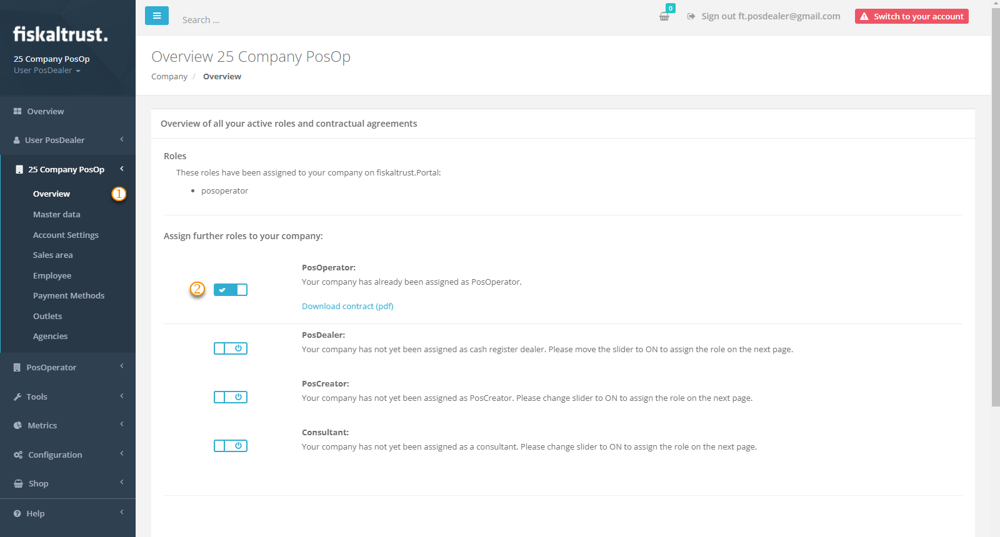
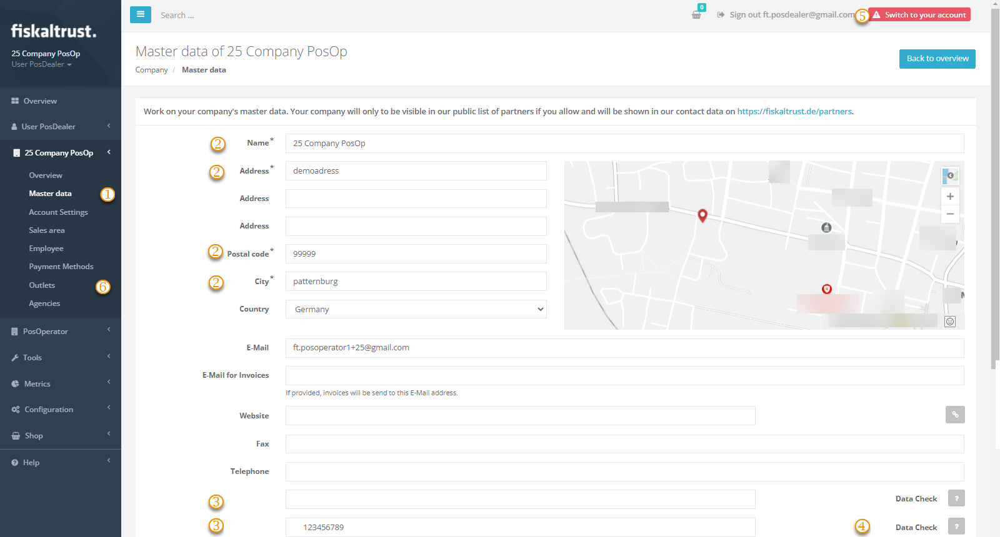

# Surrogating

:::info summary
After reading this, you can explain the prerequisites for acting on behalf of a PosOperator in the fiskaltrust.Portal, and you can do it.
:::

fiskaltrust distinguishes company roles in the fiskaltrust.Portal. The end users of POS systems activate the role contract of a **PosOperator**; distributors of POS systems activate the role contract of a **PosDealer**. For more information, see [Company Roles](../company-roles.md).

To support and maintain a PosOperator's POS system, you, as a PosDealer, switch from your account to the PosOperator's account, change settings, assign contracts or order products, and switch back to your account. This is called **surrogating**.

Surrogating always works with your account and one PosOperator account; there is no bulk action. This page uses checking a PosOperator's master data as the example.

## Prerequisites

1. Your PosDealer account is set up and ready to use.
2. You have configured the invitation settings as described in [Preparation of invitations](invitation-process.md#preparation-of-invitations). The `Surrogate rights` setting defines your permission level in the PosOperator's account.
3. The PosOperator has accepted the invitation by activating the role contract.
4. There have been no changes to other role contracts or to your authorizations.
5. The PosOperator's account is active. To check, choose `PosDealer` > `PosOperators`:
   - If the PosOperator's name is an active link, the account is active.
   - If the PosOperator's name is not an active link, your invitation has not been accepted yet. Follow the instructions in [Troubleshooting](invitation-process.md#troubleshooting).

:::tip
To get an overview of active and inactive PosOperator accounts, for example to contact them, choose `Export as CSV` on the list of PosOperators (`PosDealer` > `PosOperators`).
:::

## Switch to a PosOperator account

*Figure 1. Finding and selecting a PosOperator.*

| Step | Description |
|:----:|-------------|
| |Choose `PosDealer` > `PosOperators`. |
| |Enter a search term for the PosOperator. |
| |Press `Enter` or choose the search icon. The list shows the PosOperators whose name or e-mail address matches the search term. Without a search term, all PosOperators are shown. |
| |If the PosOperator's name is an active link, the account is active. Choose the link to switch to the PosOperator's account. |

*Table 1. Steps to find and switch to a PosOperator account, shown in Figure 1.*

## Work in the PosOperator account

*Figure 2. The fiskaltrust.Portal after switching to a PosOperator account.*

| Step | Description |
|:----:|-------------|
| |In the PosOperator's account, you act with your own user. Your user name and e-mail address are still displayed. |
| |The view is similar to your own account. The PosOperator's company name shows that you are working in another account. A banner also states that you are acting on behalf of the PosOperator. |
| |Every product you buy in the shop while surrogating is added to the **shopping cart** and is available after you switch back to your account. |
| |To switch back to your account, choose `Back to your account` in the upper right corner. |
| |Do not leave the PosOperator's account by signing out, because your **shopping cart** would be lost. |

*Table 2. Working in and leaving a PosOperator account, shown in Figure 2.*

## Check the PosOperator's master data

*Figure 3. Overview of the PosOperator account.*

| Step | Description |
|:----:|-------------|
| |After signing in (PosOperators) or switching to the PosOperator's account (PosDealers), choose `Company info` > `Overview`. |
| |Check that the PosOperator role, and no other role, is activated. Otherwise, cancel the undesired role. For more information, see [Company Roles](../company-roles.md). |

*Table 3. Checking the PosOperator's activated roles, shown in Figure 3.*

*Figure 4. Master data page of the PosOperator account.*

| Step | Description |
|:----:|-------------|
| |After checking the roles, choose `Company info` > `Master data`. |
| |Check the address fields. Optionally, enter a dedicated e-mail address for invoices in `Primary Billing E-Mail`. |
| |Check that the tax identification numbers are complete. They are not mandatory for the invitation process, but they are the basis for correct cash register management and a prerequisite for using third-party services. |
| |Validate the values with `Data Check`. Save your changes before you leave the page. |
| |Do not return to your account with `Back to your account` yet (PosDealers), and do not sign out yet (PosOperators). |
| |Choose `Outlets` and check the outlets for completeness and correctness. For more information, see [Master data](master-data.md). |
| |Choose `Back to your account` to return to your account and check the accounts of other PosOperators. |

*Table 4. Checking and validating the PosOperator's master data, shown in Figure 4.*

:::caution No access to employee data for PosDealers
For data privacy reasons, you cannot manage the PosOperator's employee data in the fiskaltrust.Portal when you have switched to a PosOperator account as a PosDealer.
:::
