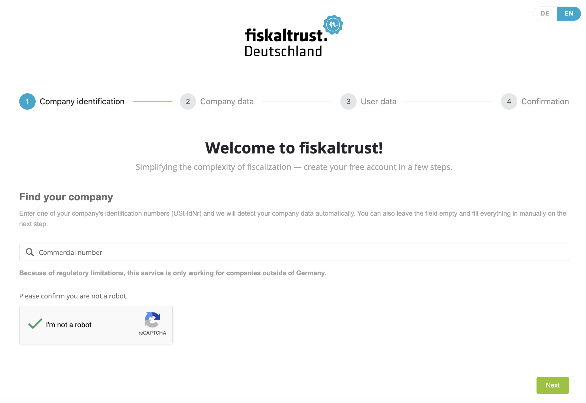
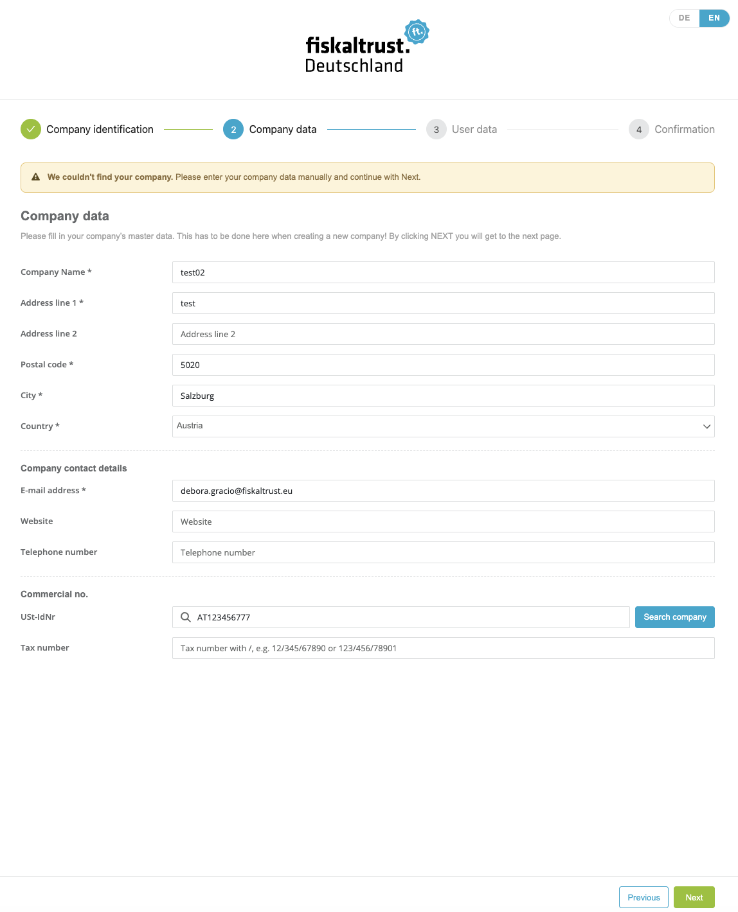
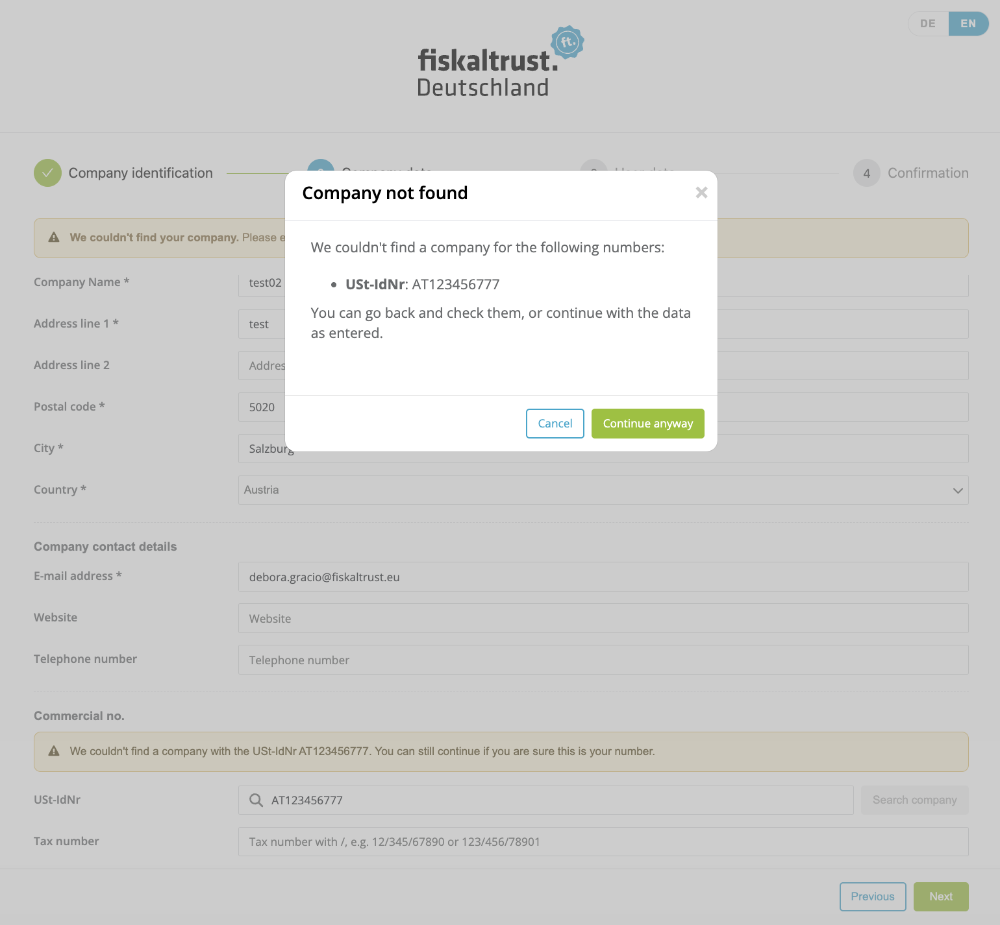
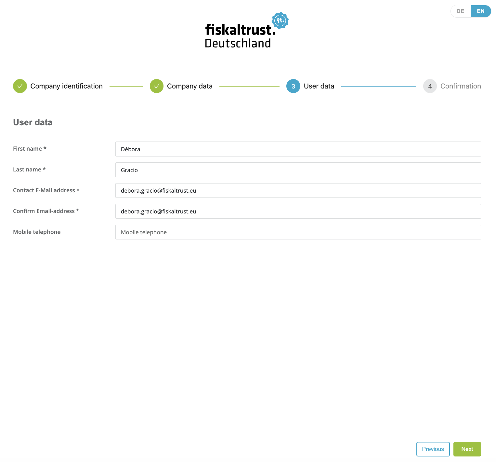
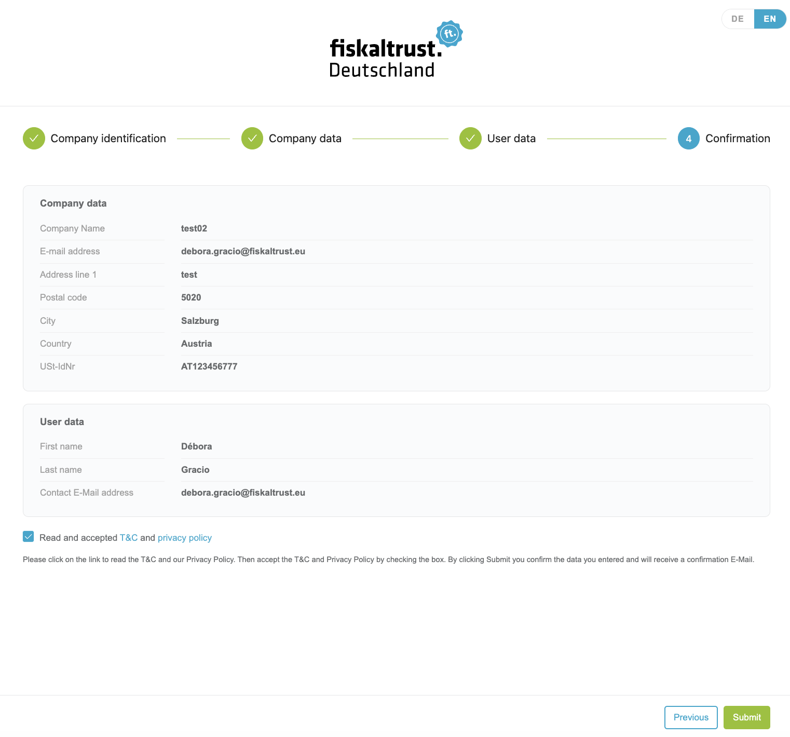
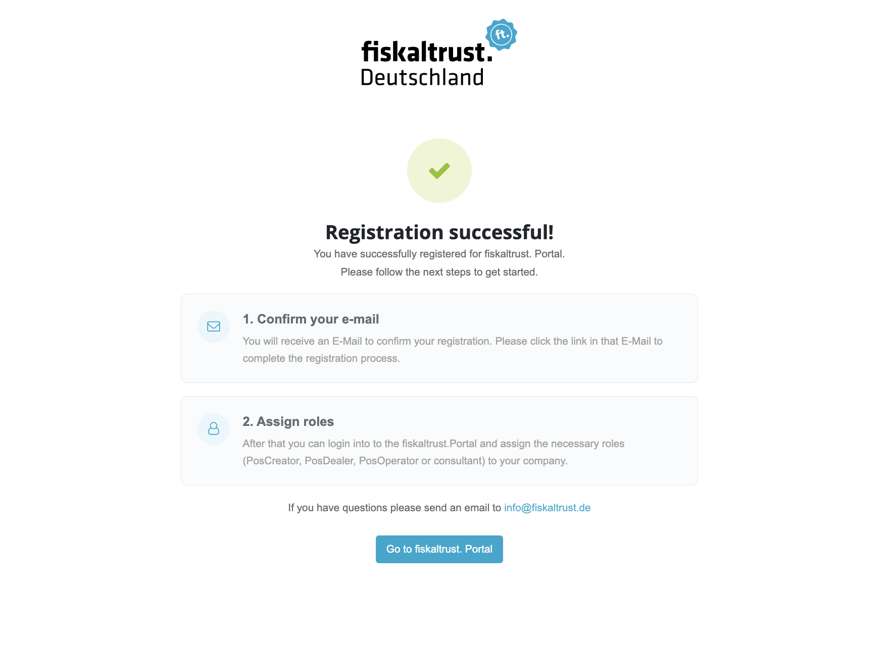
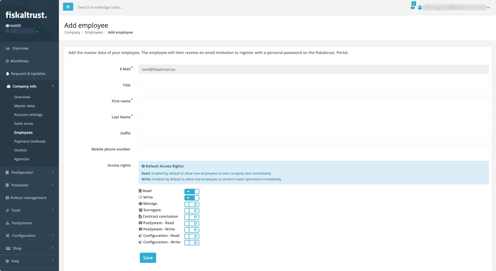
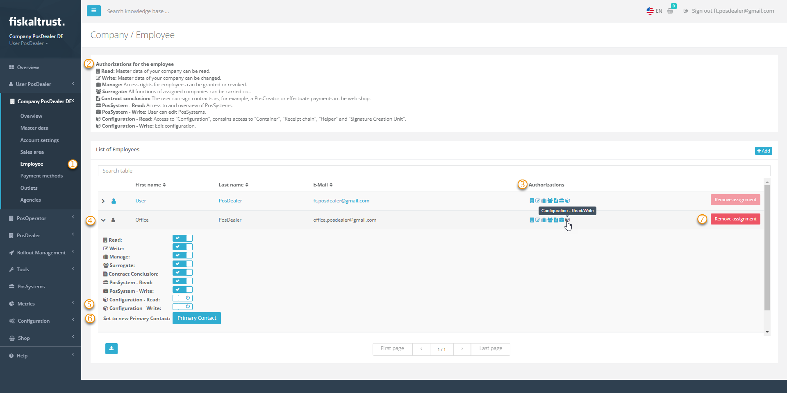
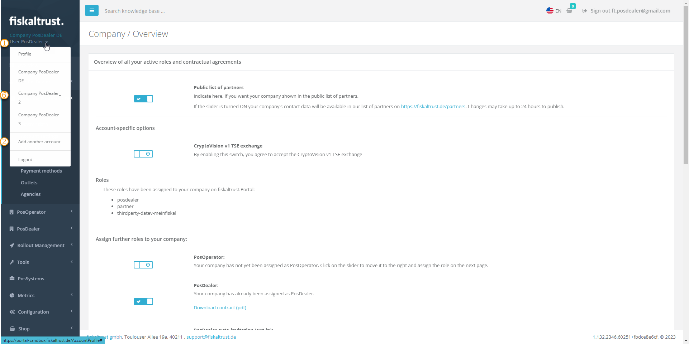

# Registration

:::info summary

After reading this, you can create an account in the fiskaltrust.Portal, log out and log in again, invite employees and assign them different rights.

:::

You register an account for your company and a user for yourself in the fiskaltrust.Portal. With this user, you log in. For security reasons, you can create another user for yourself, as well as additional users for the employees of your company. Authorizations define what each user can do in the fiskaltrust.Portal. Frequently asked questions are answered in the [Troubleshooting](#troubleshooting) section.

## Before you start

* A company E-Mail address that is not yet used for a company in the fiskaltrust.Portal.
* An E-Mail address for the Primary Contact (the key user of your company) that is not yet used by another fiskaltrust.Portal user.
* Optionally, an identification number of your company (for example, the VAT number) to look up and prefill your company data.

## Portal URLs

You reach the registration and the login through a link on the fiskaltrust website or directly through the URL for your market:

import Tabs from '@theme/Tabs';
import TabItem from '@theme/TabItem';
import RegistrationAT from '../_markets/at/getting-started/registration/_registration.mdx';
import RegistrationBE from '../_markets/be/getting-started/registration/_registration.mdx';
import RegistrationFR from '../_markets/fr/getting-started/registration/_registration.mdx';
import RegistrationDE from '../_markets/de/getting-started/registration/_registration.mdx';
import RegistrationGR from '../_markets/gr/getting-started/registration/_registration.mdx';
import RegistrationIT from '../_markets/it/getting-started/registration/_registration.mdx';
import RegistrationPL from '../_markets/pl/getting-started/registration/_registration.mdx';
import RegistrationPT from '../_markets/pt/getting-started/registration/_registration.mdx';
import RegistrationES from '../_markets/es/getting-started/registration/_registration.mdx';

<Tabs groupId="market">

  <TabItem value="AT" label="Austria">
    <RegistrationAT />
  </TabItem>

  <TabItem value="BE" label="Belgium">
    <RegistrationBE />
  </TabItem>

  <TabItem value="FR" label="France">
   <RegistrationFR />
  </TabItem>

  <TabItem value="DE" label="Germany">
   <RegistrationDE />
  </TabItem>

  <TabItem value="GR" label="Greece">
    <RegistrationGR />
  </TabItem>

  <TabItem value="IT" label="Italy">
    <RegistrationIT />
  </TabItem>

  <TabItem value="PL" label="Poland">
    <RegistrationPL />
  </TabItem>

  <TabItem value="PT" label="Portugal">
    <RegistrationPT />
  </TabItem>

  <TabItem value="ES" label="Spain">
    <RegistrationES />
  </TabItem>

</Tabs>

:::caution Login security

Whenever you enter your username and password for the fiskaltrust.Portal, make sure the URL is one of the above and look for the **lock** symbol in the browser. A secure site always shows a closed padlock in the URL bar. This way, you enter your data on the correct website and avoid becoming a victim of website or login spoofing.

:::

## Register a company

On the login page, select `Register` to register a company and an associated user. Registration is independent of the company's future role (PosCreator, PosDealer, Consultant or PosOperator) in the fiskaltrust.Portal.

The registration wizard has four steps: **Company identification**, **Company data**, **User data** and **Confirmation**.

* A step tracker at the top of the wizard shows the steps. Click any completed step to jump back to it.
* Each step has its own address: you can move between steps with the browser's Back and Forward buttons and reload a step without losing your entries.
* Pressing `Enter` in a field advances to the next step when the data of the current step is complete.
* The wizard opens in your market's language. Use the language toggle in the top right corner (for example, `DE`/`EN`) to switch to English at any time. In markets where the wizard opens in English, there is no toggle.

### Step 1: Company identification

The first step is headed **Find your company** and contains a single search field.

1. Enter any identification number your market supports. You do not need to choose the number type first.
2. In the productive Portal, confirm the reCAPTCHA under the search box by checking the checkbox. Sometimes reCAPTCHA opens a popup with a task (for example, select all images with traffic lights) before it finishes the verification. You solve the captcha once; the same confirmation covers the rest of the registration. The Sandbox skips this check.
3. Select `Next`. The Portal detects the number type and prefills your company data.

To enter all company data manually, leave the field empty and select `Next`.

*Figure 1. Company identification: the "Find your company" search step.*

The numbers you can look a company up by depend on your market:

| Market   | Identification numbers |
|:---------|------------------------|
| Austria  | VAT number, Steuernummer, GLN, Firmenbuchnummer (company register number) |
| Belgium  | VAT number |
| France   | VAT number, TIN, GLN, SIREN |
| Germany  | VAT number (USt-IdNr). Because of regulatory limitations, this lookup only works for companies **outside** Germany. |
| Greece   | VAT number |
| Italy    | VAT number |
| Poland   | VAT number |
| Portugal | VAT number |
| Spain    | VAT number |

*Table 2. Identification numbers you can search a company by, per market.*

Most markets look a company up by its VAT number only. Additional market-specific commercial numbers, such as the German tax number or the Polish NIP, are entered in step 2 and are not used for this lookup.

### Step 2: Company data

Enter your company's master data. If you used the lookup in step 1, the fields are prefilled and the number you searched by is locked; otherwise, you enter all data yourself. Fill in all fields marked with an asterisk.

*Figure 2. Company data step of the fiskaltrust.Portal registration.*

| Group | Fields and rules |
|:------|:-----------------|
| **Company data** | `Company Name`, `Address line 1`, `Postal code`, `City` and `Country` are required; `Address line 2` is optional. The company name must match the name in the commercial registers and must not already be in use for a registration. |
| **Company contact details** | A valid `E-mail address` is required. It can only be used once for a company in the fiskaltrust.Portal. If your E-Mail server supports "+" in the address (username+tag@domain is delivered to username@domain), each alias counts as a unique address, which is useful for testing. `Website` and `Telephone number` are optional. |
| **Commercial no.** | The commercial and tax numbers your market uses (for example, in Germany the `USt-IdNr` and the `Tax number`). Select `Search company` next to a number to verify it against the registers and optionally prefill the form from it. |

*Table 3. Field groups of the Company data step shown in Figure 2.*

Select `Next` to verify the entered numbers and proceed to step 3, **User data**.

:::note Company not found

When you select `Next`, the Portal verifies every commercial number you entered that a register can check. If none of the registers recognizes a number, a **Company not found** dialog names the number. Choose:

* `Cancel` to stay on this step with your data intact and correct the number.
* `Continue anyway` to keep the number as entered and move on to the user data.

:::

*Figure 3. The "Company not found" dialog shown when a number is not recognized.*

:::tip Company or E-Mail already registered

* If a commercial number you entered already belongs to a registered company, the Portal tells you that a company with this number is already registered with fiskaltrust, and advises you to have that company invite you or to log in.
* If the company E-Mail address is already in use, the Portal marks the E-Mail field and tells you that the address already belongs to a registered fiskaltrust account. Log in if the account is yours; otherwise, use a different company E-Mail address.

To join an existing company, ask its Primary Contact to invite you as a new user.

:::

### Step 3: User data

Enter the personal data of the Primary Contact. The Primary Contact is the key user of the fiskaltrust.Portal and the designated administrator of the newly registered company. With their authorization, this user can invite other employees of the company.

| Field | Required | Note |
|:------|:--------:|:-----|
| `First name` | Yes | |
| `Last name` | Yes | |
| `Contact E-Mail address` | Yes | Must be valid: the fiskaltrust.Portal sends all messages to this address. |
| `Confirm Email-address` | Yes | Re-enter the contact E-Mail address. |
| `Mobile telephone` | No | |

*Table 4. User data fields for the Primary Contact.*

*Figure 4. User data form for the Primary Contact of the company.*

:::tip E-Mail address already in use

If the address entered in `Contact E-Mail address` is already in use in the fiskaltrust.Portal, a warning shows that a user with this E-Mail address already exists. Click the link in this warning to start the password reset for this user.

:::

### Step 4: Confirmation

The last step shows a summary of the company and user data you entered.

1. Read the Terms & Conditions and the Privacy Policy and accept them with the checkbox. The `Submit` button stays disabled until you do.
2. Select `Submit` to create the registration.

*Figure 5. Confirmation step with the data summary and the Terms & Conditions checkbox.*

After you submit, a message confirms the successful registration. The confirmation screen lists your next two steps: confirm the E-Mail address, then assign the company's roles (PosCreator, PosDealer, PosOperator or Consultant). The Portal also sends an E-Mail with all the necessary information to the Primary Contact's E-Mail address.

*Figure 6. Successful registration message with the next steps.*

### Confirm the E-Mail address

Open the E-Mail in the Primary Contact's inbox and click the confirmation link. If you do not find the E-Mail in your inbox, check the spam folder of your E-Mail application. Depending on where you register, the E-Mail comes from one of these addresses:

<Tabs groupId="market">

  <TabItem value="AT" label="Austria">
     no-reply-sandbox@fiskaltrust.at or no-reply@fiskaltrust.at

  </TabItem>

  <TabItem value="BE" label="Belgium">
     no-reply-sandbox@fiskaltrust.be or no-reply@fiskaltrust.be

  </TabItem>

  <TabItem value="FR" label="France">
     no-reply-sandbox@fiskaltrust.fr or no-reply@fiskaltrust.fr

  </TabItem>

  <TabItem value="DE" label="Germany">
    no-reply-sandbox@fiskaltrust.de or no-reply@fiskaltrust.de

  </TabItem>

  <TabItem value="GR" label="Greece">
     no-reply-sandbox@fiskaltrust.gr or no-reply@fiskaltrust.gr

  </TabItem>

  <TabItem value="IT" label="Italy">
     no-reply-sandbox@fiskaltrust.it or no-reply@fiskaltrust.it

  </TabItem>

  <TabItem value="PL" label="Poland">
     no-reply-sandbox@fiskaltrust.pl or no-reply@fiskaltrust.pl

  </TabItem>

  <TabItem value="PT" label="Portugal">
     no-reply-sandbox@fiskaltrust.pt or no-reply@fiskaltrust.pt

  </TabItem>

  <TabItem value="ES" label="Spain">
     no-reply-sandbox@fiskaltrust.es or no-reply@fiskaltrust.es

  </TabItem>

</Tabs>

:::info Expired link

Confirmation links expire after 24 hours. If your link is invalid or has expired, an information page appears when you click it, and you automatically receive a new confirmation E-Mail.

:::

Your account is now active. To log in to the fiskaltrust.Portal, use the link in the final confirmation screen or the `PORTAL-LOGIN` button on the fiskaltrust website.

## Reset password

If you have lost or forgotten the password for the fiskaltrust.Portal, request a password reset:

1. On the login screen of the fiskaltrust.Portal, click the link `If you have forgotten your password please click here:`.
2. Solve the CAPTCHA.
3. Enter the E-Mail address you used when registering your account and select `SEND LINK`.
4. A confirmation shows that the password-reset link has been sent to the E-Mail address you entered. If the E-Mail does not arrive, check that the address is the one you used when you registered your account.
5. After a few minutes, check the inbox of this E-Mail address. Click the link in the E-Mail to open the password-reset page of the fiskaltrust.Portal.
6. Enter the E-Mail address of your fiskaltrust account and the new password, and confirm the password by entering it a second time.
7. Select `Reset` to save the new password. A confirmation page appears, and you can log in to the fiskaltrust.Portal again.

When you are logged in, you change your password in the user menu (the menu under your name at the top right) > `Change password`.

## Create new users

You can create another user for yourself, for example for security reasons, and add users for your company's employees. Authorizations define the options each user has in the fiskaltrust.Portal.

### Invite a new user

**Prerequisite:** your user has the `Manage` authorization.

1. Select `Company info` > `Employees`, then `Add`.
2. Enter the E-Mail address of the new user in `E-Mail` and select `Search`.
3. On the `Add employee` page, complete the **required** master data `First name` and `Last Name`. Optionally, add `Title`, `Suffix` and `Mobile phone number`.

   

   *Figure 7. The `Add employee` page with the default access rights `Read` and `Write` enabled.*

4. Under `Access rights`, set the authorizations: switch to the right to enable a right, to the left to disable it. `Read` and `Write` are enabled by default, so new employees can view company data and perform basic operations immediately. At least `Read` must be enabled.
5. Select `Save`. The new user receives an invitation to their E-Mail address. Inform them about the next steps and ask them to check their spam folder in case the invitation is filtered out. The new user must use this invitation to confirm their E-Mail address, set a password and link their account in the fiskaltrust.Portal with your company.

### Activate the invitation (new user)

1. The new user checks the inbox of the E-Mail address used for the invitation.
2. The new user opens the confirmation link, reads and accepts the T&C and the Privacy Policy, and sets a password. This activates the new user.

From then on, all users log in through the links listed in [Portal URLs](#portal-urls) or in the assignment message.

## Manage user rights

### Change user rights

*Figure 8. Employee authorizations management in the fiskaltrust.Portal.*

| Steps | Description |
|:-----:|-------------|
| | Select `Company info` > `Employees`. |
| | `Authorizations for the employee` explains each authorization. |
| | Check the existing rights in the `Authorizations` column. Inactive rights have a black symbol, active rights a blue symbol. |
| | To change the authorizations of a user, expand the line with the arrow on its left edge. |
| | Switch to the right to activate a right, to the left to deactivate it. A confirmation message appears at the top right. |
| | At `Set to new Primary Contact`, select `Primary Contact` **only if you want to hand over all** authorizations. Only employees with the `Manage` right can be set as the Primary Contact. |
| | Select `Remove assignment` to remove the user's assignment to your company. You cannot remove the assignment of the Primary Contact. |

*Table 5. Steps to change user rights, shown in Figure 8.*

### Remove access rights

| Action | Effect |
|:-------|:-------|
| `Remove assignment` | Removes only the assignment of the E-Mail address to the company. For security reasons, the user is not deleted. |
| `Set to new Primary Contact` | **Immediately and completely** withdraws the access rights of the previous Primary Contact. After the next logout, the former Primary Contact cannot log in to the fiskaltrust.Portal at all. The new Primary Contact must grant the former contact access to the company again. |

*Table 6. Actions for removing access rights.*

## Troubleshooting

### Employees complain about access

*Figure 9. Flowchart for diagnosing access complaints of employees.*

### Employees of PosOperators complain about access

The process in [Create new users](#create-new-users) (`Company info` > `Employees` > `Add`) also applies to adding employees to PosOperator accounts.

:::caution No access to employee data for PosDealers

For data privacy reasons, as a PosDealer you cannot manage the employees of a PosOperator in the fiskaltrust.Portal when you switch to the PosOperator's account.

:::

### PosDealers have several companies

Each E-Mail address maps one-to-one to a single account. The same address therefore cannot be used for two or more companies, neither as a Primary Contact nor as an employee.

#### Solution for employees

**We strongly recommend testing this process in the Sandbox first.**

1. Select `Company info` > `Employees` > `Add`.
2. Add data records, if necessary with fictitious information. Only the E-Mail address must be correct, for example `peter.pattern@mycompany.com`.
3. If employees are assigned to several accounts, create alias addresses and use these, for example `peter.pattern+1@mycompany.com`, `peter.pattern+2@mycompany.com` and so on.

#### Solution for Primary Contacts

**We strongly recommend testing this process in the Sandbox first.**

You can use one E-Mail address to access different companies, but only if all of these prerequisites are met:

* The companies are not yet created and can be added manually in the fiskaltrust.Portal.
* You avoid creating companies more than once.
* The E-Mail address is used exclusively as the Primary Contact in the new companies.

*Figure 10. Switching between companies with the drop-down under the company name in the sidebar header.*

1. In the sidebar header (top left), click your company name to open the drop-down.
2. Select `Add another account`.
3. Add the desired data for the E-Mail address of the current registration.
4. Add an existing, correct VAT number to prevent problems with orders and commissioning.
5. Create the new company with the `Create` button.
6. To switch from company to company, open the drop-down under your company name again and select the company.
7. Make sure **not to create the same company** more than once.
8. Note that several companies mean **different legal bindings**, for example separate contracts.

### Invitation was sent to the wrong recipient

#### Solution for Primary Contacts

You received your company's first invitation to the fiskaltrust.Portal, but you will not be working as the Primary Contact. The easiest approach is to accept the invitation, invite your designated colleague yourself and set them as the new Primary Contact. Unless they reassign access rights to you, you then have no access or further responsibilities.

1. You, as a new user, check the inbox of the E-Mail address used for the invitation.
2. Use the confirmation link to activate the invitation. Read and accept the T&C and the Privacy Policy and add a password.
3. Select `Company info` > `Employees` > `Add`.
4. Enter the E-Mail address of the desired user and select `Search`.
5. Complete the **required** master data.
6. Enable all access rights, including `Manage`, and select `Save`. Note that this alone does not make the new user the Primary Contact.
7. Inform the new user about the next steps: they must use the invitation to confirm their E-Mail address and set a password.
8. The new user checks the inbox of the E-Mail address used for the invitation and opens the included link. They read and accept the T&C and the Privacy Policy, add a password and inform you about their registration in the fiskaltrust.Portal.
9. You, as the Primary Contact, select `Company info` > `Employees` and expand the line of the desired employee.
10. At `Set to new Primary Contact`, select `Primary Contact`, confirm with `Set Primary Contact` and log out.
11. The new user becomes the Primary Contact the next time they log in. If they wish, they can grant you access rights; otherwise, you have no further access or responsibilities.

#### Solution for PosDealers

You sent an invitation to a PosOperator with the wrong E-Mail address. As a PosDealer, you can redirect the invitation to another recipient as long as the original recipient has not yet activated it.

1. Log in to the fiskaltrust.Portal and select `PosDealer` > `Invitation`.
2. Search for the wrongly used E-Mail address and select `Edit` in its line.
3. Change the E-Mail address in both `Email-address` and `Contact Email-address`, and select `Save`.
4. Resend the invitation E-Mail with the resend action in the invitation's line (tooltip `Resend invitation to this PosOperator`).

For more information, see [Invitation process](operator-onboarding/invitation-process.md).
